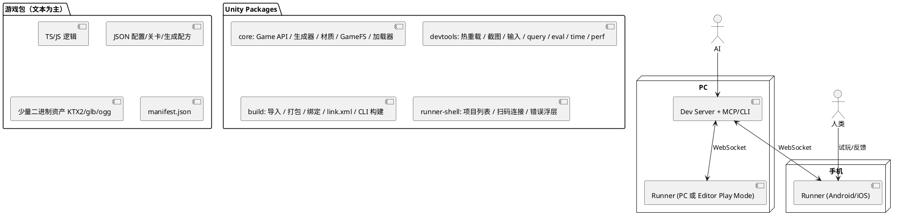

# 001 pot：Game Runner 设计文档（草案）

状态：草案；原型 v0.1 已实现，与本文的差异见第 16 节。热重载见 002
引擎：Unity + Puerts（UE 作为远期可选内核）

## 1. 背景与目标

现在的游戏动辄几个 G。程序化生成可以做到“资产即代码”，用算力换存储：资源不存成文件，存的是生成它的代码和参数，在运行时生成。AI 写代码的成本很低，这个思路因此变得实用。参考样例：`几猫国产3A大作_V1.html` 是单个 HTML 文件，原始 1.36 MB，gzip 后约 437 KB（其中包含 Three.js），所有内容都在运行时生成。

商业引擎的编辑器是给人用的，让 AI 通过 Computer Use 操作编辑器既慢又不可靠。引擎真正有价值的是运行时系统（动画、物理、寻路、渲染、LOD 等）和资源管线，这些跟编辑器界面无关。

目标：

- 原生支持 AI 快速开发游戏：游戏就是 JS/TS 代码加 JSON 配置，AI 改完能马上加载运行，通过 MCP/CLI 拿到日志和截图、操作角色，再修改，形成闭环。
- 人可以轻量预览：电脑或手机上实时看效果、试玩、提意见，不需要打开 Unity 编辑器。
- 保留商业引擎的运行时内核、性能和多平台能力。

## 2. 定位与非目标

- Runner 只当开发工具，类比 Expo Go。它是一个 Unity 工程，可以运行在 PC 和手机上，用来加载和调试游戏包。
- 发布由游戏开发者用 Unity 正常打包，产物是普通的独立 App，类比 Electron 模式或 Expo 的 EAS Build。
- 不做“通用游戏平台”，即一个运行器在线加载任意第三方游戏。这样可以避开版号和平台资质、iOS 动态代码审核、引擎授权、第三方代码沙箱这些问题。
- 不追求 Runner 里能现写任意着色器，原因见第 8 节。

## 3. 先例参考

| 先例 | 可借鉴点 |
|---|---|
| Expo Go / EAS Build | 开发运行器加独立打包的模式；“自定义开发客户端”的教训 |
| LÖVE | 原生运行器加脚本包的最小形态 |
| Roblox | 单一运行器、脚本化、高层 API 设计 |
| 微信小游戏 | 宿主加 JS 包的分发模式 |
| OneJS | Unity 加 JS、热重载、UI 方案 |

## 4. 总体架构



分层原则：

- 原生层（C# + Burst/Jobs，必要时 C++ 插件）：通用生成器和引擎运行时，基本不变。
- GPU 层：通用 uber 材质和“着色器即数据”解释器，JS 只传参数和数据。
- JS 层：玩法逻辑、内容配方、组合编排。批量数据用 `ArrayBuffer` 一次性传给原生层，避免逐顶点跨语言调用。

## 5. 包划分

| 包 | 类型 | Runner | 发布工程 | 内容 |
|---|---|---|---|---|
| `core` | Runtime | 有 | 有 | Game API、Puerts 静态绑定、原生生成器、uber 材质和变体集、`GameFS`、游戏加载器 |
| `devtools` | Runtime | 有 | 无 | 与 Dev Server 的连接、热重载、截图、输入注入、`query`/`eval`、时间控制、性能统计 |
| `build` | Editor | 可选 | 有 | 导入游戏目录、打包 JS、处理资源、生成 `link.xml` 和绑定、命令行构建（`-batchmode`） |
| `runner-shell` | Runtime | 有 | 无 | Runner 自身界面：项目列表、扫码连接、错误浮层 |

约束：

- Runner 工程等于 `core` + `devtools` + `runner-shell`（可加 `build`）；发布工程等于 `core` + `build` + 游戏包。
- `devtools` 用独立程序集，通过 asmdef 的 `defineConstraints` 控制，保证发布包里不带任何开发代码。
- Runner 工程可以直接在 Unity Editor 的 Play Mode 里运行，需要深度调试时可用 Profiler 和 Frame Debugger。

## 6. 游戏包格式

```
my-game/
  manifest.json
  src/            TS 源码，入口 main.ts
  data/           JSON：关卡、生成配方、动画状态机、UI 描述
  assets/         少量二进制资产（KTX2/Basis、glb+meshopt、ogg/opus）
  types/          Game API 的 d.ts（由 core 包提供，版本锁定）
```

`manifest.json` 示例：

```json
{
  "id": "com.example.mygame",
  "name": "My Game",
  "version": "0.1.0",
  "entry": "src/main.ts",
  "apiVersion": "1.0",
  "unityVersion": "2022.3.x",
  "packages": {
    "com.xxx.pot.core": "1.0.0"
  },
  "capabilities": ["mesh.procedural", "material.uber", "physics", "audio.synth"],
  "extraPackages": []
}
```

- `apiVersion` 和 `packages` 用于校验 Runner 与发布工程使用同一组包版本。
- `capabilities` 用于能力检查，构建时也据此裁剪着色器变体。
- `extraPackages` 声明额外的 Unity 包，需要时构建自定义 Runner（见第 12 节）。

## 7. Game API 设计原则

1. 高层、声明式：把引擎内核封装成高层能力，比如实体、角色控制器、动画状态机（JSON 描述）、物理、寻路、地形、光照预设、粒子预设、相机、输入、UI、音频。不要只暴露底层的网格和 Draw 接口，否则等于在引擎上重写一遍 Three.js。
2. 版本化：API 发布后长期向后兼容，并通过能力等级声明，类似浏览器的 feature level。
3. 只走 Game API：游戏不直接反射访问 Unity 或 .NET 类型。所有 API 都有 Puerts 静态绑定，并在 `link.xml` 中保留，确保 IL2CPP 裁剪后依然可用。
4. 对 AI 友好：完整的 `d.ts` 和注释，错误信息结构化，参数尽量是可序列化的数据。
5. 可复现：固定步长、全局随机种子、时间缩放，为自动化测试和截图比对服务。

首批 API（20 到 30 个，MVP 范围）：场景与实体、Transform、程序化网格、uber 材质、程序化贴图、相机、灯光预设、角色控制器、物理（刚体、碰撞、射线）、输入（键鼠、触屏、摇杆）、UI 文本和按钮、音效合成、计时器、随机数、存储、日志。

## 8. 渲染与着色器策略

Three.js 能在运行时现写着色器，是因为 WebGL 规定着色器以 GLSL 源码提交，浏览器自带编译链路（如 ANGLE）。Unity 和 UE 出于变体规模、PSO 卡顿、编译器体积、平台限制和材质元数据等原因选择离线预编译。

目标：Runner 不变，游戏就能实现网页上能做到的任意效果；Runner 不依赖 Editor。因此着色器是游戏内容，不是 Runner 的一部分。

主路线：着色器作为游戏内容，Runner 运行时编译 GLSL ES（原生插件 `native/pot_gfx`）。

- 游戏包里放 GLSL ES 3.10 源码（`data/shaders/*.frag|vert`），通过 `ctx.gfx.shader()` 加载，`entity.shader()` / `entity.uniforms()` 绑定，和其他数据一样热重载。
- 编译链：glslang → SPIR-V → SPIRV-Cross → 目标平台语言（D3D11 为 HLSL SM5.0 后再 D3DCompile；GLES/WebGL 为 GLSL 300 es；Metal 为 MSL）→ 驱动编译。这与浏览器（ANGLE）的做法同构，Unity 自身的跨平台着色器管线也是同一套工具。
- 绘制：在 URP 的 `AfterRenderingOpaques` / `AfterRenderingTransparents` 两个 pass 中，由原生插件用 URP 当前的颜色和深度目标直接绘制，因此与普通物体正确遮挡，透明物体按由远到近排序；后处理照常作用。物体仍由普通 Renderer 投射阴影（ShadowsOnly）。
- 内置 uniform 与库：`pot_Model/View/Proj/...`、`pot_Time`、太阳光、环境光、雾、反射探针；`<pot/varyings>`、`<pot/standard.vert>`、`<pot/lit>`（GGX + 半球环境光 + 环境反射 + 雾）。只写片元着色器即可得到与场景一致的光照。
- 出错不丢画面：编译失败时保留同名旧程序，错误按 `#line` 映射回游戏源文件和行号。
- 烘焙：`ctx.gfx.bake()` 用全屏程序画到新建的 RenderTexture（支持 MRT、sRGB/浮点格式、mip 与过滤设置），对应网页上 `WebGLRenderTarget` + 全屏 pass 的用法，程序化材质、查找表、法线生成都由游戏自己写，Runner 不需要为新材质升级。几猫的 27 种原版材质就是这样机械移植的。
- 代价：编译器约 3 MB；首次编译在加载时发生，单个程序几十到几百毫秒（jimao 40 个程序合计约 4 秒）。编译结果按源码哈希缓存到 `persistentDataPath/cache/shaders`，第二次打开直接加载。暂不接收阴影，暂不进入 URP 的深度预通道和 SSAO。

备用：着色器即数据。固定的解释器着色器读取 Buffer 或贴图中的表达式字节码，在某平台无法运行时编译时（例如受限的小游戏环境）作为降级方案。

已作废：Dev Server 调用 Editor 编译着色器。它让开发依赖 Editor，且发布期仍需变体管理，不满足“Runner 不变”的目标。

普通材质（uber 材质加参数和开关）继续保留，用于不需要自定义效果的物体。变体管理：`core` 自带 `ShaderVariantCollection` 和 Always Included 配置；`build` 根据 `capabilities` 裁剪变体，并预热 PSO。

### 复刻几猫发现的 Runner 能力缺口

通过机械移植原版网页（three.js r180）逐项找出 Runner 缺的通用能力。状态说明：✅ 已完成，❌ 未完成，⚠️ 可用但与原版有出入。

**汇总**

| 状态 | 数量 |
|---|---|
| ✅ 已完成 | 23 |
| ⚠️ 有出入 | 7 |
| ❌ 未完成 | 29 |

#### 渲染与着色器（gfx）

| 状态 | 能力 | 发现场景 | 说明 / 建议 |
|---|---|---|---|
| ✅ | GPU 烘焙到贴图 `gfx.bake` | 初始移植 | MRT、sRGB、mip、过滤与环绕 |
| ✅ | 原生帧数据槽按票号索引 | 初始移植 | 原 16 槽环形缓冲，同帧大量提交会互相覆盖 |
| ✅ | 自定义着色器接收主光阴影 `pot_Shadow` | 初始移植 | C# 按 URP 同算法复算级联矩阵，绑定 `pot_ShadowMap`，3×3 PCF、reversed Z、距离淡出 |
| ✅ | 镜面抗锯齿 | 地面 | `pot_Lit` 把像素内法线变化折算进粗糙度（同 three geometryRoughness） |
| ✅ | 点光与聚光 `pot_AdditionalLights` | 初始移植 | 每物体最多 16 个，衰减与 URP 相同 |
| ✅ | 平面反射开放给 gfx `pot_PlanarReflection` | 初始移植 | 原能力仅 PotLit 可用，现绑定 `pot_PlanarMap` / `pot_PlanarVP` |
| ✅ | 倒影扰动可控 `PotSurface.planarOffset` | 雨滴涟漪 | 原来只按法线做 0.05·距离 的世界偏移，比原版 RR 弱一个数量级，涟漪看不见；现可直接给屏幕 uv 偏移，且倒影 mip 改用镜面抗锯齿之前的粗糙度 |
| ✅ | 雾与内置材质同源 `pot_FogColor` | 初始移植 | 读 `_PotFog*`，含高度雾与太阳方向散射 |
| ✅ | 直射高光可调 `specular` / `specularMax` | 海面 | 对应原版改写 directSpecular 的补丁，新增 `pot_BRDFLight` |
| ✅ | 雾之前插入效果 `pot_LitColor` | 海面 | `pot_Lit = pot_ApplyFog(pot_LitColor(...))` |
| ✅ | 关闭视锥剔除 `frustumCull: false` | 雨 | 顶点着色器重算位置的效果（雨、粒子）不再时有时无 |
| ✅ | 自定义后处理链 `gfx.post` | 后处理 | 全屏 pass 链、按比例或固定尺寸目标、`history` 双缓冲、内置 `scene` / `depth` |
| ✅ | three 方言 `gfx.standard` / `dialect: 'three'` | 枪模、场景材质 | three r180 的 meshphysical 原文与 ShaderChunk 直接编译，支持 `onBeforeCompile` 补丁（`threeChunks`）；光照、阴影、雾、环境改读 pot 内置。枪模 Bf 与场景 sl 材质 h3 已换回原版原文，D3D11 上 60fps |
| ❌ | `pot_gfx` 只有 D3D11 后端 | WebGL 版 | WebGL / GLES / Metal 下运行时着色器全部不可用，画面退回 PotLit；下一步做 GLES3 后端 |
| ✅ | 屏幕空间内置量 | 后处理 | `pot_ScreenVP/InvVP`、`pot_DepthParams`、`<pot/post>` 的深度与世界坐标重建 |
| ⚠️ | 遮蔽只有一个 `ao` | 海面 | 原版只遮直射与漫反射 IBL；建议拆成 diffuse / specular / direct 三项 |
| ⚠️ | 高光钳制逐光源进行 | 海面 | 原版是所有光源之和钳到 40，只在多光源极亮时有差别 |
| ⚠️ | 镜头污渍改为程序噪声 | 后处理 | 原版用噪声贴图，外观接近 |
| ⚠️ | 雷电只作用于后处理 | 后处理 | 与原版一致，但没有闪电对物体的直射光和闪电几何 |
| ❌ | gfx 物体不进平面反射 | 地面 | 镜像相机也要挂 GfxPass 并用其矩阵打包 |
| ❌ | 附加光阴影 | 地面 | 路灯光斑不会被集装箱挡住，需复算附加光阴影图集矩阵 |
| ❌ | 实例化 `instances` | 雨 | 现在把实例展开成普通网格，顶点数与上传量 4 倍；建议 `DrawIndexedInstanced` |
| ❌ | 自定义顶点属性 `attributes` | 雨 | 只能借用 normals / uvs，colors 会被转线性 |
| ❌ | 相机内置量 `fov`、渲染分辨率 | 雨 | 现在从 `pot_Proj[1][1]` 反推 |
| ❌ | 后处理 pass 读阴影图 | 后处理 | 体积光（god rays）因此未移植 |
| ❌ | 后处理链与 `scene.post` 可共存 | 后处理 | 链生效时 SSAO、景深一起失效；建议提供 URP 后处理之后的挂点 |
| ❌ | 后处理 pass 单独开关 | 后处理 | 关 Bloom 只能把强度置零；建议 `enable(i, on)` |

#### 内置材质与场景

| 状态 | 能力 | 发现场景 | 说明 / 建议 |
|---|---|---|---|
| ⚠️ | 内置材质世界空间效果 | 初始移植 | 宏观亮度/粗糙度变化、雨痕水珠、远距离抖动镂空只覆盖了湿润 |
| ❌ | 内置材质顶点动画钩子 | 远景 | 闪灯、海鸥靠 `uTime` 顶点动画，目前闪灯常亮、海鸥跳过 |
| ❌ | HDR 顶点色 | 远景 | 远景灯带用大于 1 的顶点色发光，Bloom 是否吃到待确认 |
| ✅ | 批量变换同步 `scene.setTransforms` | 远景、机器狗 | 一次跨语言调用写一批实体，每个 10 个数（位置、四元数、缩放），可只写部分分量，可选世界或本地空间；传 `Int32Array` 的 id 时不产生分配。jimao 每只敌人每帧的同步从约 0.087 ms 降到约 0.015 ms（含蒙皮带来的部件减少）；远景动态网格只下发本帧变化的那几个 |
| ⚠️ | 蒙皮网格 | 机器狗 | 已支持：`scene.mesh` 带 `boneIndices` / `boneWeights` / `bindPoses`，`spawn({ shape: 'mesh:x', bones })` 建成蒙皮网格；三平面贴图按静止姿态采样。机器狗每只的网格渲染器从约 30 个降到 4 个（[hound.ts](games/jimao/src/lib/hound.ts)）。剩余出入：每顶点多根骨骼的软权重只有单元测试，没在实机上验证过；蒙皮实体不能用运行时着色器（gfx），所以飞鸥仍是刚性分件；蒙皮实体没有碰撞体，命中体另挂在骨骼下 |
| ✅ | 只碰撞不渲染的实体 `visible: false` | 机器狗 | `spawn({ visible: false, collider: true })` 或 `entity.visible(false)`：只关渲染，碰撞体与子节点照常工作，运行时着色器那条绘制路径也跟着不画。机器狗头、身、腿三个命中体已改用，原来是画一层全黑的叠加材质 |
| ❌ | 半透明材质双面 | 飞鸥 | `lit-fade`/`unlit-fade` 只渲染正面，原版旋翼残影盘是 DoubleSide，现在正反各建一片；建议 `MaterialOptions.cull` |
| ❌ | 点光源物理单位选项 | 远景 | three 强度/π 与 distance 的换算写在游戏里 |
| ✅ | Canvas 2D 绘制 `scene.canvas` | 初始、地面、弹孔 | 软件光栅（路径、渐变、描边、clip、evenodd、合成模式），文字由宿主 OS 字体栅格化；弹孔图集 1024×512×3 约 128 ms |
| ✅ | 退化网格不建碰撞体 | 弹孔 | 动态池初始全零，原来 `mesh:` spawn 总挂 MeshCollider，PhysX 报错且每次更新重烘焙 |
| ❌ | gfx 深度偏移 `polygonOffset` | 弹孔 | 贴花现靠沿法线外推 4 mm 防 z-fighting，远处或掠射角仍可能闪 |
| ❌ | 网格切线属性 `tangents` | 弹孔 | 法线贴图用 dFdx/dFdy 重建切线框架，三角形边缘有轻微接缝 |
| ⚠️ | 粒子预设 `scene.burst` 只有 spark/smoke/glow | 水花 | 原版水柱、拉伸水珠、水平涟漪环、预乘混合都没有；jimao 自建粒子池（[fx.ts](games/jimao/src/lib/fx.ts)），每帧把粒子展开成四边形动态网格上传 |
| ❌ | 普通 gfx 网格读场景深度 | 水花 | 原版软粒子按深度差淡出，现在水柱与地面交界处是硬边；建议透明队列可绑定 `pot_SceneDepth` |
| ❌ | 顶点属性通道不足 | 水花 | 粒子要 16 个浮点（中心、尺寸、轴/滚转、颜色、帧号、模式、年龄、明暗），只能塞进 position/normal/uv/color 并对 color 做 sRGB 逆变换 |
| ❌ | 射线可附带无限平面 | 水花 | 地坪没有碰撞体，打地面原来是"未命中"；jimao 按原版在射线后再与 y=0 地面、y=-1.6 海面求交 |

#### 物理与运行时

| 状态 | 能力 | 发现场景 | 说明 / 建议 |
|---|---|---|---|
| ✅ | `physics.addBox` 接受 `{x,y,z}` | 穿墙 | 原来 557 个碰撞盒有 452 个是 NaN |
| ❌ | 动态碰撞与 MeshCollider | 远景 | 中继、闸杆等会动的网格挡不住射线，大块静态网格只能用盒子近似 |
| ❌ | 固定步长 `fixedUpdate` | 穿墙 | 后台约 4 fps 时 dt≈0.25 s 会跨过空气墙；jimao 用子步兜底 |
| ❌ | `state.define` 的 `validate` | 穿墙 | 存档会原样恢复越界、卡墙等坏状态 |
| ✅ | 跨热重载缓存网格 `scene.mesh(name, fn, { key })` | 远景 | key 相同时直接复用 Runner 里的网格，生成函数也不调用；`key: true` 由运行时按内容算哈希。同时着色器程序在源码没变时不再重新编译。world 单元热重载实测从约 6.3 秒降到 0.17 到 0.26 秒。更正原诊断：那 6 秒里网格重建只占约 1 秒，约 4.5 秒花在材质与着色器上 |
| ❌ | Dev Server 不拒绝第二个 Runner | 性能排查 | 两个 Runner 连同一端口会互相顶替连接并反复重连，画面掉到约 4 fps，日志里只有"新的 Runner 连接，替换旧连接"；建议拒绝后来者，或被顶替的一方停止重连并在画面上提示 |
| ❌ | 加载器支持 `export const a = 1, b = 2` | 水花、飞鸥 | 开发期源码加载器只导出第一个变量，其余运行时未定义，tsc 不报错；已踩两次，应在 devtools 的转译里修正或在 `pot check` 里报错 |
| ✅ | 启动加载进度与让帧 `ctx.loading` | 启动卡顿 | 启动是一长串同步 JS，窗口不刷新像卡死。单元 apply 可写成 async，在阶段间 `await ctx.loading.step('文字', 进度)`：回报进度给 Runner 外壳画加载界面（标题、进度条、阶段文字、已用秒数），本帧连续执行超过 50 ms 时让出一帧。没报进度的游戏也会显示"加载 单元名"和不确定进度条。jimao 启动期间窗口始终有响应 |
| ✅ | 着色器编译缓存 | 启动卡顿 | 原生插件按（后端、编译器版本、vs、fs）哈希把反射信息与 DXBC 存到 `persistentDataPath/cache/shaders`，命中时跳过 glslang、SPIRV-Cross 和 D3DCompile。jimao 冷启动 9.8 秒（40 个程序全部编译），第二次打开 3.8 秒（命中 40/40）。启动日志打印耗时与命中数 |
| ❌ | 关卡构建与转译缓存 | 启动卡顿 | 缓存后剩下的 3.8 秒主要是关卡构建（buildLevel、origLevel 约 1.3 秒）、网格上传约 0.5 秒和源码转译；可按源码哈希缓存转译结果，网格按 key 持久化到磁盘 |

#### UI

| 状态 | 能力 | 发现场景 | 说明 / 建议 |
|---|---|---|---|
| ✅ | 相机滚转 | 菜单 | `lookAt` 后改 `camera.rotation.z` 即可，无需新增 |
| ❌ | 渐变 `gradient` | 菜单 | 现用约 180 个 6px 条带近似 |
| ❌ | 字距 `spacing` | 菜单 | 现按字绘制并缓存单字宽度 |
| ❌ | 字重档位、等宽字体 | 菜单 | 900/600/500 被压成两档 |
| ❌ | `rgba()` 颜色 | 菜单 | 只认十六进制 |
| ❌ | 行/列布局辅助 | 菜单 | 目前全部手算坐标，尚可接受 |

## 9. 资产即代码

- 优先生成：地形、建筑、低多边形模型、材质和贴图、粒子、合成音效。
- 不适合生成的内容：角色动画、配音、音乐、写实贴图等，以压缩格式放进 `assets/` 或通过 CDN 按需下载。
- 生成耗时：分帧生成，优先生成玩家附近的内容。生成结果缓存到本地（原始网格和贴图数据），第二次启动直接读缓存。
- 发布时可选烘焙：在编辑器里用同一份脚本预先生成，产出普通 Unity 资源，交给引擎管线压缩和优化。一份代码两种用法。
- 资产代码只依赖纯数学库：建模代码只产出顶点、法线、UV、顶点色和索引，不碰渲染器、DOM 和引擎对象。这样同一份代码可以在浏览器、Node 和 Runner 里运行，也能直接搬运现成的 Web 资产代码（例如 Three.js 的几何体与 BufferGeometryUtils，按源文件打成 vendor 放进游戏包）。坐标系与色彩空间的差异在出口统一转换一次，建模代码本身保持原样。jimao 的枪模就是这样从原版机械移植的，改动只有函数名。
- 外观差距分三层：几何（可直接移植）、材质参数（颜色、粗糙度、金属度，可直接移植）、着色器补丁（原版的 onBeforeCompile，由游戏自带 GLSL 实现，见第 8 节）。

## 10. 开发闭环

### 10.1 连接拓扑

MCP 服务放在电脑上，不放在手机里。所有 Runner 通过局域网 WebSocket 连到电脑上的 Dev Server，Android 也可以用 `adb reverse`。

- AI 只面对一个 MCP，不需要关心目标设备是哪台。
- 多台设备（PC、Android、iOS）可以同时连接，对比效果和真机性能。
- 人在手机上试玩时，AI 能同时读取这台设备的日志和截图。

### 10.2 MCP/CLI 工具集（初版）

| 工具 | 作用 |
|---|---|
| `devices` | 列出已连接的 Runner |
| `load` | 加载或切换游戏包 |
| `reload` | 触发热重载（细节见第 14 节） |
| `logs` | 结构化日志与错误，含 source map 映射后的 TS 栈 |
| `screenshot` | 截图，可指定相机和分辨率 |
| `input` | 注入按键、摇杆、点击，或高层指令（如“移动到 X”） |
| `query` | 读取场景树、实体和游戏状态（结构化，优先于截图） |
| `eval` | 在游戏上下文中执行 JS |
| `time` | 暂停、单步、加速、设置种子 |
| `perf` | 帧时间、DrawCall、内存 |
| `record` / `replay` | 输入录制与回放，用于复现问题和回归测试 |

原则：判断状态和逻辑用 `query`，判断视觉效果才用 `screenshot`。

### 10.3 人类协作

- 人在 Runner 里试玩，可以在错误浮层或反馈入口留下意见（文本加当前截图加状态快照），由 Dev Server 转给 AI。
- 人的参数微调最好写回 JSON，让 AI 下一轮能读到。

## 11. 开发期与发布一致性

核心原则：发布工程和 Runner 用同一份 `core`，Runner 只比它多 `devtools` 和 `runner-shell`。

| 风险 | 对策 |
|---|---|
| IL2CPP 裁剪掉 JS 反射访问的成员 | 只走 Game API；静态绑定；`core` 自带 `link.xml` |
| 着色器变体被裁导致材质变粉、PSO 卡顿 | 变体集加按能力裁剪加 PSO 预热 |
| 资源路径不同 | 统一的 `GameFS` 抽象：开发期从 Dev Server 读，发布期从 StreamingAssets 或 Addressables 读 |
| JS 形态不同 | 开发期按模块加载，发布期用 esbuild 打成单文件（可选字节码），模块解析规则保持一致 |
| 版本不一致 | `manifest` 锁定 Unity 版本和包版本，`build` 校验 |

建议在 CI 中对发布包跑同一套 `record`/`replay` 回归，提前发现差异。

## 12. 发布流程与自定义 Runner

发布：使用通用壳工程 `player/`（已引入 `core`、`build`、Puerts 和 URP），执行 `node js/devserver/cli.js release <游戏目录> --platform win64,android,webgl`。脚本先把 TS 编译打包为 `bundle.cjs`，读取 manifest 生成发布配置，再通过 Unity `-batchmode` 自动导入资源、生成启动场景并出包，无需打开编辑器。详见 [003 自动发布打包](003-release.md)。

自定义 Runner：游戏需要通用 Runner 没有的原生能力（SDK、C# 插件）时，在 `manifest.extraPackages` 中声明，再用 `build` 一键构建包含这些扩展的专属 Runner。自定义着色器不在此列，它属于游戏内容（第 8 节）。这样可以避开 Expo Go 早期“通用客户端跑不了自定义原生代码”的问题。

## 13. 风险与待定事项

- API 覆盖面不足：初期的主要瓶颈，靠实际游戏需求反向推动 API 迭代。
- 跨语言开销：热路径必须留在原生层，需要在原型阶段测量。
- iOS 上 Runner 的安装：走 TestFlight，或开发者用自己的证书从 Runner 工程编译安装。
- 微信小游戏：Unity WebGL 或团结引擎的转换路径可行，Puerts 在小游戏上的支持程度待实测。
- UE 内核：包体大，没有 Web 和小游戏平台，远期作为“高画质原生 Runner”考虑。API 层尽量设计成与引擎无关。
- 运行时着色器的平台覆盖：目前只有 D3D11 后端；Vulkan、GLES、Metal 后端待实现。iOS 允许运行时编译 MSL（`newLibraryWithSource`），WebGL 直接提交 GLSL，小游戏环境待实测。

## 14. 热重载

详见 `002-hot-reload-design.md`。要点：

- 用 cordis 管理生命周期：每个游戏插件是一个 fiber，`dispose` 自动回收它注册的一切；Game API 以 `ctx` 服务的形式提供，原生资源也归属到 fiber。
- 持久数据统一放在常驻的 `state` 服务里，插件只放逻辑，场景是状态的投影。热重载只替换插件，状态保留。
- 重载是事务：先预加载新代码，再替换，失败自动回滚；提交后做泄漏检查。
- 处理不了的变化走冷重启，状态通过快照保留。

## 14.1 经验积累

框架面向 AI，开发约定、模板和踩过的坑都积累在随 Runner 发布的 Skill（`pot-game-dev`）中，版本与 `apiVersion` 一起管理。能由框架保证的坑，优先改框架。

## 15. MVP 里程碑

1. 最小 Runner：Unity + Puerts，加载本地目录中的游戏包，文件变动后热重载。
2. 首批 20 到 30 个高层 Game API 及 `d.ts`。
3. Dev Server 加 MCP，先做 `reload`、`logs`、`screenshot`、`input`、`query`、`time` 六个工具。
4. 手机 Runner 通过 WebSocket 连接 Dev Server。
5. 让 AI 用 Runner 开发一个小游戏（例如移植 `几猫国产3A大作_V1.html`），记录卡点，指导下一轮 API 和工具迭代。
6. `build` 包跑通发布流程，并对发布包做一致性回归。

## 16. 原型实现（v0.1）

已实现 MVP 里程碑 1、3、4、6 的最小版本，以及第 2 项中的场景、灯光、相机、输入、计时器、数据、状态。目录结构：

```
pot/
  packages/com.pot.core          Runtime：PotRuntime、GameFS、PotScene、PotInput、PotBoot、core.cjs
  packages/com.pot.devtools      Runtime：PotDevClient（WebSocket、命令、截图、虚拟输入）、devtools.cjs
  packages/com.pot.runner-shell  Runtime：PotRunner（地址设置、状态与错误浮层）
  packages/com.pot.build         Editor：PotBuild（导入游戏、启动场景、BuildPlayer）
  runner/                        Runner Unity 工程（Unity 2022.3）
  js/runtime                     @pot/core（cordis 服务）
  js/devtools                    hmr、开发命令处理
  js/devserver                   Dev Server、CLI、MCP（stdio）
  games/hello                    示例游戏
  skills/pot-game-dev            AI 开发用 Skill
```

与前文设计的差异：

| 项 | 设计 | 原型 |
|---|---|---|
| 包名 | `core` 等 | `com.pot.core`、`com.pot.devtools`、`com.pot.runner-shell`、`com.pot.build` |
| 游戏包 | `entry: src/main.ts` | `manifest.plugins` 列出根单元，`src/plugins/*.ts` 每个文件一个单元 |
| 绑定 | Puerts 静态绑定 | 反射模式：JS 只调用 `CS.Pot.*` 的少量静态方法，参数为数字和字符串；用 `link.xml` + `[Preserve]` 防裁剪 |
| devtools 隔离 | asmdef `defineConstraints` | 发布工程不引入该包；`core` 通过事件和钩子暴露扩展点，不引用 devtools |
| GameFS | Dev Server / StreamingAssets | 磁盘目录 `Root`（Runner：游戏源码目录、.potg 解压目录或 HTTP 镜像目录）→ `Resources/pot-game`（发布包） |
| 加载与热重载 | Dev Server 构建并推送 | Runner 自己读源码（devtools 内置 sucrase 转译 TS，保留行号）、自己监听变化并热重载；Dev Server 只是 AI 通道，启动不需要游戏路径 |
| 连接 | 多设备 | 同一时间一个 Runner，后连接的替换先连接的；Runner 后台静默连接与重连 |
| MCP 工具 | `devices`、`reload`、`perf`、`record` 等 | `pot_status/logs/open/restart/reload/check/eval/state/query/plugins/leaks/time/input/screenshot` |
| Runner 界面 | 项目列表、扫码 | IMGUI 首页（输入框 + 最近打开）、游戏中状态条、错误浮层、面板（F1 或三指触摸） |

### 16.1 Runner 协议

WebSocket 路径 `/runner`，JSON 文本帧。

| 方向 | 消息 |
|---|---|
| Runner → Dev | `{type:'hello', platform, unity, device, game}` |
| Runner → Dev | `{type:'log', level, text}`；`{type:'event', name:'reload'|'game', data}` |
| Dev → Runner | `{type:'open', id, path?, files?, url?, reset}`：同机用 `path`，否则用 `url`，或 Runner 拼出 `http://<Dev 地址>` + `files` 镜像 |
| Dev → Runner | `{type:'restart'|'home'|'screenshot'|'input', id, ...}`：由 C# 处理 |
| Dev → Runner | 其他命令（`reload`、`changed`、`eval`、`state`、`query`、`time`、`leaks` 等）：交给 JS `pot.devtools.handle` |
| Runner → Dev | `{type:'result', id, ok, data|error}` |

HTTP：`GET /files/<相对 root 的路径>`，目录返回递归清单 `{files:[{path,size,mtime}]}`，文件直接返回内容（忽略 `.pot`、`node_modules`、`.git`，越界 403）。

### 16.2 验证情况

- JS：32 项用例（运行时、源码加载与共享模块、热重载事务与回滚、启动失败单元自动恢复、泄漏检查、Dev Server 转发与 `/files`）。
- Unity：Win64 Runner 实测：`PotRunner.exe games/hello` 不开 Dev Server 直接运行并热重载；无参数 `pot dev` 后 Runner 自动连上，`pot open` 本地目录、`http://127.0.0.1:7788/files/games/hello/` 镜像（轮询热重载）、`.potg` 均可打开；启动时语法错误的单元修好后自动挂载；截图、eval 正常。
- 发布：通用 `player/` 壳工程与 `pot release` 已实测 `games/jimao` 三平台构建；Win64 独立 exe 正常启动（启动日志显示从 Resources 加载，着色器缓存命中 37/37），Android 产出 ARM64 APK（真机未验证），WebGL 在浏览器正常进入游戏。WebGL 排查并修复了 Puerts 后端和碰撞体被 IL2CPP 裁剪的问题，以及无原生 gfx 后端时材质回退不完整的问题。
- 运行时着色器（D3D11）：`PotRunner.exe games/shaders` 实测，水面（alpha）、全息球（add）、顶点变形方块（自定义 vert + frag）均正确绘制，与普通材质的柱子遮挡正确，方块正常投影；修改 `.frag` 后热重载生效，故意写错时浮层显示 `shaders/holo.frag:12` 的错误，画面保持旧程序。JS 用例增至 35 项。

尚未实现：Android/iOS 真机验证、程序化网格与 uber 材质、物理、UI、音频、`record`/`replay`、多设备。
