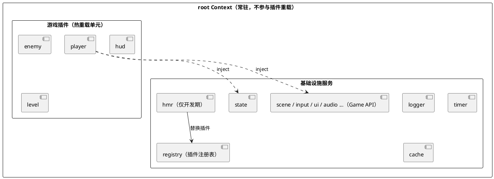
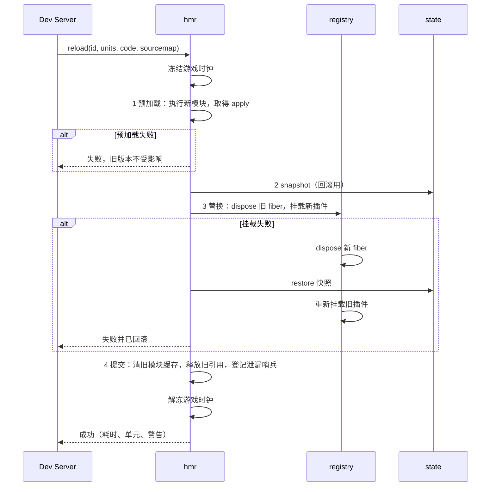

# 002 pot：热重载设计（基于 cordis）

状态：设计定稿 v1；原型 v0.1 已实现，与本文的差异见第 16 节
上级文档：`001-game-runner-design.md` 第 14 节
参考实现：`D:\CordisPuertsDemo`（cordis 4.0.0-rc.8 + Puerts V8）

## 1. 目标

AI 或人改完代码后，Runner 在 1 秒内切到新代码，游戏状态不丢，旧代码留下的东西全部清掉。新代码有错时保持旧版本继续运行，并把结构化的错误返回给 AI。

具体要求：

- 不丢状态：改逻辑不用从头玩回现场。
- 不留残余：旧版本的监听、定时器、场景对象、原生资源全部回收，可以验证。
- 失败可回退：编译、执行、挂载任一步失败都自动退回旧版本。
- 可观测：每次重载的范围、耗时、错误、泄漏检查结果都能通过 MCP 获取。
- 与发布一致：开发期和发布期用同一套插件模型和状态服务，热重载相关代码不进发布包。

## 2. 选型

生命周期框架用 cordis core，热重载服务自己实现。

| 项 | 决定 | 原因 |
|---|---|---|
| 生命周期 | cordis core（Context / Plugin / Fiber / Service） | `fiber.dispose()` 按注册的反序回收一切，清理由结构保证；零 Node 依赖，可在 Puerts V8 中运行（demo 已验证） |
| 版本 | 把源码放进仓库并锁定 `4.0.0-rc.8` | 还是 RC，API 可能变化 |
| 热重载服务 | 自研 `hmr` 服务 | 官方 `@cordisjs/plugin-hmr` 依赖 chokidar、`node:path` 和 Node 内部 ModuleLoader，无法移植；只借鉴它的骨架：分析依赖、清模块缓存、`registry.delete` 后重新挂载、失败回滚 |
| 变更检测 | Dev Server 推送 | 手机上的 Runner 看不到电脑的文件，轮询读文件也太浪费 |
| 模块失效 | `puer.module.deleteModuleCache` | 确定性失效，不依赖 GC |

## 3. 运行时结构



分两层：

- 基础设施：cordis、Game API 服务、`state`、`cache`、`registry`、`hmr`。它们属于 Runner 的 `core` 和 `devtools` 包，游戏代码不能修改它们，热重载时也不替换。
- 游戏插件：游戏包 `src/plugins/` 下的每个入口模块是一个热重载单元，由 `registry` 统一加载和挂载。

## 4. 编程约定（强制）

下面这些约定是热重载能工作的前提。它们会写进 AI 开发用的 Skill（见第 12 节）。Game API 的类型和运行时检查也会尽量强制执行。

1. 持久数据只放在 `state` 服务里。插件闭包、模块顶层、服务实例上只能放可以随时重建的派生数据。
2. 所有副作用都通过 `ctx` 注册：事件用 `ctx.on`，定时器用 `ctx.interval`/`ctx.timeout`，场景对象用 `ctx.scene.spawn`，其他资源用 `ctx.effect`。禁止直接调用 `setInterval`、直接 `new` Unity 对象、在全局事件上挂回调。
3. 访问服务必须先声明 inject。
4. 模块顶层不能有副作用：只能写导出、常量和纯函数。热重载会先执行新模块、再卸载旧模块，顶层副作用会执行两遍。
5. 场景是状态的投影：插件挂载时根据 `state` 重建场景，运行中把引擎侧的变化（位置、刚体速度、动画进度等）写回 `state`。
6. 插件模块的导出格式固定：

```ts
// src/plugins/player.ts
import type { Context } from '@pot/core'

export const name = 'player'
export const inject = ['state', 'scene', 'input']

interface PlayerState {
  hp: number
  pos: [number, number, number]
}

export function apply(ctx: Context) {
  const s = ctx.state.define<PlayerState>('player', {
    version: 2,
    init: () => ({ hp: 100, pos: [0, 1, 0] }),
    migrate: (old: any, from: number) =>
      from === 1 ? { hp: old.hp, pos: [old.x, 1, old.z] } : undefined,
  })

  const body = ctx.scene.spawn({ shape: 'capsule', position: s.pos })

  ctx.on('update', (dt: number) => {
    const move = ctx.input.axis('move')
    body.move(move.x * 5 * dt, 0, move.y * 5 * dt)
    s.pos = body.position
  })
}
```

`registry` 把它包装成 cordis 对象插件（`{ name, inject, apply }`）后再挂载。插件之间的父子关系通过 `ctx.use('enemy')` 声明，由 `registry` 解析，不写静态 import。这样每个插件都是独立的热重载单元。

## 5. state 服务

### 5.1 定位

`state` 注册在 root 上，热重载过程中一直保留。它是所有持久数据的唯一归属，可以理解为游戏的“内存数据库”。开发期它支撑热重载不丢状态、`query`、快照、`record`/`replay`、冷重启恢复；发布期它就是存档系统的数据源。所以 `state` 属于 `core` 包，发布时同样存在。

### 5.2 API

```ts
interface StateService {
  define<T>(key: string, opts: {
    version?: number
    init: () => T
    migrate?: (old: unknown, fromVersion: number) => T | undefined
  }): T
  get<T>(key: string): T | undefined
  snapshot(keys?: string[]): StateSnapshot
  restore(snap: StateSnapshot): void
  reset(key: string): void
}
```

`define` 的规则：

- key 不存在：调用 `init` 创建。
- key 存在且版本相同：直接返回已有对象，这就是热重载保留状态的关键。
- key 存在但版本不同：调用 `migrate`；返回 `undefined` 或抛错时，回退到 `init`，并输出一条 warning 日志说明状态被重置。
- 同一个 key 被两个不同插件 `define`：报错。

### 5.3 数据约束

- 只允许可序列化的数据：JSON 兼容的值，加上 TypedArray（用于高度图这类大块数据）。不允许函数、类实例、Unity 对象、Promise。开发期 `define` 和 `snapshot` 时会做类型检查，违规直接报错并指出路径。
- 场景对象用 id 或描述引用，不存对象本身。
- 程序化生成的内容不放 `state`，只放生成配方和种子；生成结果放在 `cache` 服务（见 5.4）。
- 快照用自己实现的深拷贝（JSON 加 TypedArray 处理），不依赖 `structuredClone`，裸 V8 环境不一定提供它。

### 5.4 cache 服务

“场景是状态的投影”意味着每次热重载都要重建场景。为了不让重建变慢，生成器的结果按 `hash(生成器版本, 配方, 种子)` 缓存在常驻的 `cache` 服务里。插件重新挂载时走缓存，几乎没有成本。`cache` 里的内容可以随时丢弃，丢掉不影响正确性，按内存预算做 LRU 淘汰。

## 6. Game API 的 ctx 化

每个会创建资源的 Game API 都以服务形式提供，调用时把资源挂到调用方的 fiber 上，fiber dispose 时自动释放。实现方式与 demo 里的 `TimerService` 相同（`this.ctx` 绑定为调用方）。

| API | 资源 | dispose 时 |
|---|---|---|
| `ctx.scene.spawn` | GameObject 及其组件 | Destroy |
| `ctx.asset.load` | 贴图、网格、音频 | 引用计数减一，归零后卸载 |
| `ctx.input.on` / `ctx.ui.*` | 输入回调、UI 元素 | 注销、销毁 |
| `ctx.audio.play` | 播放实例 | 停止 |
| `ctx.interval` / `ctx.timeout` | 定时器 | clear |
| `ctx.effect` | 自定义资源 | 执行清理函数 |

开发期 `scene` 服务记录每个 GameObject 属于哪个 fiber，`query` 工具可以按插件列出它创建的对象，泄漏检查也基于这份记录。

## 7. 变更分类与重载范围

Dev Server 根据改动的文件和构建依赖图（esbuild metafile）决定重载方式：

| 改动 | 方式 | 说明 |
|---|---|---|
| 插件模块 | 插件重载 | 只替换这个插件 |
| 被插件 import 的共享模块 | 插件重载 | 替换所有依赖它的插件（共享代码会打进每个插件包里） |
| `data/*.json` | 插件重载 | 数据文件也算依赖：插件通过 `ctx.data.load('levels/1.json')` 读取，Dev Server 记录读取关系 |
| `assets/*` | 资源重载 | `asset` 服务替换资源内容，持有句柄的对象原地更新，不重载插件 |
| `manifest.json`、插件清单 | 冷重启 | 见第 9 节 |
| Runner 自身（C#、core 包） | 重新构建 Runner | 不在热重载范围内 |

插件有父子关系时，父插件重载会连带子插件一起重建（cordis 的 fiber 树语义）。子插件重载不影响父插件。

## 8. 插件重载流程

整个过程是一个事务：要么全部切到新版本，要么全部保持旧版本。



步骤说明：

1. 预加载：把新代码写入 `GameFS` 的内存覆盖层，用新的缓存 key（带 hash）执行模块，读取 `name`、`inject`、`apply` 并校验格式。此时旧插件还在运行。
2. 快照：只对涉及的插件 `define` 过的 key 做快照。
3. 替换：按依赖顺序，对每个单元调用 `registry.replace(name, newModule)`，内部是 cordis 的 `registry.delete(oldPlugin)`，再用同样的配置和父级 `plugin(newPlugin)`。要 await 到 fiber 激活完成。替换期间临时接管 cordis logger 的 error 输出，cordis 内部吞掉的激活错误（比如缺少 inject）也会算作失败。
4. 提交：删除旧模块缓存条目，释放 `registry` 对旧 exports 的引用，在旧 fiber 和旧 exports 上登记 WeakRef 哨兵。

回滚的保证与边界：

- 新插件挂载到一半时产生的副作用都在新 fiber 上，dispose 后会清掉。
- 对 `state` 的修改通过快照恢复。
- 绕过 `ctx` 直接产生的副作用（违反第 4 节约定 2）无法回滚。开发期会尽量检测并报 warning。

时钟冻结保证整个替换在“两帧之间”完成，避免一帧里新旧插件同时收到 `update`。

## 9. 冷重启

插件重载处理不了的情况用冷重启：manifest 或插件清单变化、连续多次插件重载失败、AI 或人手动触发。

流程：`state.snapshot()` 序列化成 JSON，dispose root，销毁 Puerts `JsEnv`，创建新的 `JsEnv` 并加载最新代码，`state.restore()`，按插件清单挂载。状态同样保留。`cache` 在 C# 侧还有一层缓存，冷重启时可以复用。

还有一种重置：`state.reset` 加冷重启，相当于从头开始，用于 AI 需要验证“新开一局”的场景。

## 10. 泄漏检查

热重载提交后，`hmr` 在旧 fiber、旧 exports、旧插件创建过的场景对象记录上登记哨兵。经过 N 次 GC 后检查：

- 哨兵还在：报告泄漏，并给出线索，比如哪个对象还被引用、可能的原因（全局变量、绕过 `ctx` 的回调）。
- `scene` 服务里仍有归属于已 dispose fiber 的 GameObject：直接报告具体对象。

结果写进 `reload` 的返回值和 `logs`，也可以通过 `leaks` 工具主动查询。连续多次热重载后 V8 heap 持续上涨，会作为 warning 报出。

## 11. Dev Server 与 MCP

### 11.1 协议（WebSocket，JSON）

| 方向 | 消息 | 内容 |
|---|---|---|
| Runner 到 Dev | `hello` | 设备、Runner 版本、`apiVersion`、当前游戏与插件 hash |
| Dev 到 Runner | `reload` | `id`、`mode`（plugin/cold/asset）、单元列表（名称、hash、代码、sourcemap） |
| Runner 到 Dev | `reload/result` | 见下例 |
| Runner 到 Dev | `log` | 结构化日志，栈已经通过 sourcemap 映射到 TS |

Runner 连接时，如果插件 hash 与 Dev Server 不一致，自动做一次全量同步。

### 11.2 MCP 工具

| 工具 | 说明 |
|---|---|
| `reload` | 参数 `mode?`、`units?`、`device?`；默认按文件变化自动执行，也可以手动触发 |
| `state` | `get`/`set`/`snapshot`/`restore`/`reset`，用于构造测试场景、回到现场 |
| `leaks` | 查询最近 N 次重载的泄漏检查结果 |
| `plugins` | 列出插件树：名称、hash、fiber 状态、依赖、创建的对象数 |

`reload` 的返回示例：

```json
{
  "id": 42,
  "ok": false,
  "mode": "plugin",
  "units": ["enemy"],
  "phase": "mount",
  "rolledBack": true,
  "durationMs": 63,
  "error": {
    "message": "cannot get property timer without inject",
    "file": "src/plugins/enemy.ts",
    "line": 27,
    "hint": "在 inject 中加入 'timer'"
  },
  "leaks": []
}
```

AI 的自动修改默认只等编译完成后的自动重载结果，不需要额外调用 `reload`。Dev Server 会把最近一次结果附在下一次 `logs` 的返回里。

## 12. 经验积累：Skill

框架面向 AI，约定、模板和踩过的坑都通过 Skill 积累，跟着 Runner 一起维护和发布。

Skill 结构（暂定名 `pot-game-dev`）：

```
pot-game-dev/
  SKILL.md               核心规则：第 4 节约定、插件模板、开发闭环怎么用
  references/
    api.md               Game API 要点（d.ts 之外的语义说明）
    state.md             state 设计与迁移写法
    hot-reload.md        热重载行为、失败时怎么看结果
    pitfalls.md          坑点库
  templates/
    plugin.ts            插件模板
    game/                最小游戏包模板
```

规则：

- Skill 版本与 `apiVersion` 一起发布，`manifest` 中记录所用版本。
- 每次 demo 或真实开发中碰到问题，按“现象、原因、做法、来源”的格式写进 `pitfalls.md`。能被 Game API、类型或运行时检查消除的坑，优先改框架，改完后在 Skill 里标记“已由框架保证”。
- `SKILL.md` 只放高频、必须遵守的规则，细节放在 `references/` 中按需读取，控制上下文长度。

`pitfalls.md` 的初始条目（来自 CordisPuertsDemo）：

| 现象 | 原因 | 做法 |
|---|---|---|
| 调用 `ctx.interval` 失败且没有日志 | 没有 inject `timer`；cordis 默认 logger 不往外输出 | 访问服务必须声明 inject；Runner 已把 logger 接到 `logs` |
| 删除模块缓存没生效 | Puerts 缓存 key 可能是 `x.cjs` 或 `./x.cjs` | 由 `registry` 统一处理，游戏代码不要自己删缓存 |
| `lazyRequire` 返回后模块还没执行 | 返回的是 lazy proxy，第一次访问属性时才执行 | 预加载时立即读取导出，提前暴露执行错误 |
| 频繁开关插件加上频繁 GC 时 V8 崩溃 | V8 EphemeronHashTable 的 bug，cordis 的 `DisposableList` 用了 WeakMap | Runner 使用的 V8 必须包含 ephemeron 修复（demo 中有 v13.6 回移补丁） |
| 插件关闭后内存不回落 | 有对象绕过 `ctx` 持有引用 | 遵守约定 2；看 `leaks` 给出的线索 |

## 13. 发布形态

- `hmr`、Dev Server 连接、泄漏检查属于 `devtools`，不进发布包。
- `state`、`cache`、`registry`、Game API 服务属于 `core`，发布包里同样存在，行为一致。
- 发布时所有插件打成单个 bundle，`registry` 从中按名称取插件，挂载流程不变。
- `state` 的 `snapshot`/`restore` 在发布期直接用作存档。

## 14. 风险

| 风险 | 应对 |
|---|---|
| cordis 4 还是 RC | 把源码放进仓库并锁定版本；升级时跑热重载回归用例 |
| V8 ephemeron 崩溃 | 各平台 Puerts V8 后端都确认包含修复；CI 中跑高频开关加 GC 的压力用例 |
| 所有状态集中在 `state`，写法不自然或写漏 | 通过 Skill 和模板引导；`define` 做运行时校验；`query` 可以直接查看 |
| 场景重建慢 | `cache` 服务；分帧重建；实测后再考虑增量策略 |
| 插件绕过 `ctx` 导致回滚和泄漏问题 | 运行时检测加泄漏检查，并写进坑点库 |
| cordis 插件激活是异步的，错误可能延迟出现 | 替换时 await 到激活完成，并在窗口期内接管 logger error |

## 15. 原型计划

1. 在 CordisPuertsDemo 基础上实现 `registry` 和 `state`，改造 shop/mail/rank 成符合第 4 节约定的插件，验证热重载后状态保留。
2. 实现事务式重载和回滚，覆盖三种失败：预加载报错、挂载报错、缺少 inject。
3. 加入 `scene.spawn` 归属记录和泄漏检查，验证重载 100 次后 heap 回落。
4. 接入 Dev Server（esbuild watch、metafile 计算影响范围、WebSocket 推送），在手机 Runner 上实测重载耗时。
5. 实现冷重启时保留状态。
6. 整理第一版 `pot-game-dev` Skill，让 AI 用它独立完成一个小游戏，把问题写进坑点库。

## 16. 原型实现（v0.1）

计划第 1 到 6 步均已完成最小版本（第 6 步的“AI 独立完成小游戏”待做）。与前文的差异：

| 项 | 设计 | 原型 |
|---|---|---|
| 插件注册表 | `registry` | `plugins` 服务（`ctx.use(name, config)`）。每个单元有稳定的 wrapper 插件，自动注入全部核心服务，游戏代码不用写 `inject` |
| 模块加载 | Puerts 模块缓存 + `deleteModuleCache` | 不用 Puerts 模块系统：devtools 的 SourceLoader 用 sucrase 把源码转成 CJS（不改行号，`sourceURL` 为相对路径）后编译成工厂函数；共享模块按路径缓存、单元文件每次重新执行；发布包读 esbuild 打出的 `bundle.cjs` |
| 定时器 | cordis timer | 改编自 `@cordisjs/timer`，走游戏时钟：暂停、时间缩放、热重载冻结都生效，不会“补跑” |
| 变更检测 | Dev Server 推送 | Runner 自己检测：本地目录 FileSystemWatcher（去抖 150ms），手机镜像目录每秒轮询 Dev Server 的 `/files/` 清单；C# 调 `pot.devtools.changed(paths)`，SourceLoader 沿反向依赖找出受影响单元 |
| 阶段名 | preload/mount/commit | `preload`、`apply`、`commit`；内容 hash（依赖闭包合成）未变的单元记入 `skipped`；启动失败的入口单元在文件变化后重试挂载，记入 `mounted` |
| 冷重启 | 销毁 JsEnv | C# 侧 `PotRuntime.Restart(keepState)`：`exportState` → Dispose ScriptEnv → 新建 → `boot(state)`；manifest 变化自动冷重启；state 另存为存档 |
| 泄漏检查 | WeakRef 哨兵 + GC | 同设计；GC 由 JS 请求、C# 下一帧调用 `LowMemoryNotification`；另比对 JS 登记对象数与引擎实际对象数 |
| MCP | `reload`、`state`、`leaks`、`plugins` | 另有 `status`、`logs`、`open`、`restart`、`check`、`eval`、`query`、`time`、`input`、`screenshot`，统一 `pot_` 前缀；类型检查由 `pot check`（tsc）负责，Runner 只转译 |

实测（Win64 Runner）：单个单元热重载 4 到 16 ms；报错栈直接指向 `src/plugins/*.ts` 源码行并回滚，场景对象数不变。

Skill 初版位于 `skills/pot-game-dev`，坑点库已包含原型开发中遇到的 Unity 侧问题（Puerts 构建前检查、包内 `link.xml` 不生效、后台线程调用 Unity API、PowerShell 编码）。
