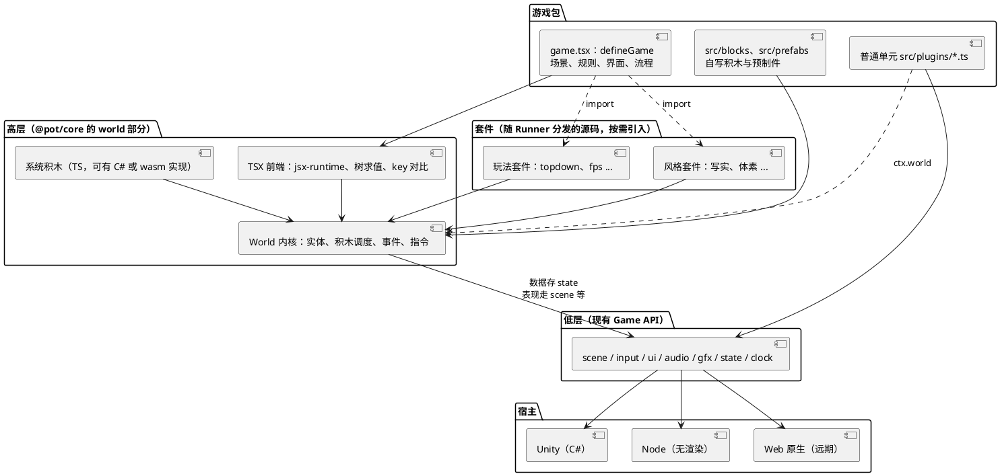
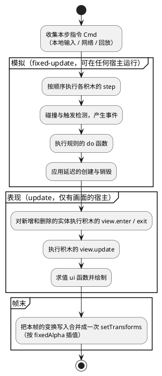

# 004 pot：高层游戏编写方式（积木与 TSX）设计文档

状态：M1 已完成，M2 实施中。方向已定：可序列化的实体数据内核，加 TSX 作为唯一的编写前端。第 14 节是远期的待决事项，M1、M2 用到的部分分别在第 15、16 节给出临时决定
上级文档：`001-game-runner-design.md` 第 7 节（Game API 设计原则）、`002-hot-reload-design.md`
修订：第 4 版。第 1 版推荐“数据内核加 JSON 与 TS 双前端”，第 2 版把两种前端合并为 TSX，第 3 版补充 M1 实施规格（第 15 节），第 4 版加入套件（6.12）：积木与预制件分系统、套件、游戏三层，系统级只留与玩法和风格无关的部分；第 5 版补充 M2 实施规格（第 16 节）

## 0. 摘要

现有 Game API（下称低层）让游戏自己处理输入、自己在 `update` 里改位置、自己把状态镜像到场景。本文在它之上加一层高层 API：游戏由现成的积木（物体、玩家、NPC、触发区、界面等）摆放和配置而成，积木不够用时退回低层自己写。高层完全用低层实现，两层可以在同一个游戏里混用。

编写形式只有一种：TSX。场景是一棵标签树，标签的属性是配置，需要逻辑的地方直接写 TS 函数。一个小写标签背后的积木可以用 TS 实现，也可以用 C# 或 wasm 实现，写游戏的人看不出区别。界面也用同一套标签写。

TSX 只是前端。它下面的内核与第 1 版相同：实体数据存在 `state` 里，模拟与表现分开，输入先变成指令再进模拟。多语言实现、脱离 Unity、联机这三项需求都靠内核满足，与前端用什么写无关。

TSX 在 pot 现有转译链上已验证可行，需要一处修正（`.tsx` 文件分两遍转译，见 5.8）。

## 1. 背景与问题

以 `games/hello` 为例，一个“方块吃金币”的游戏由 3 个单元加 1 个数据文件组成，共 2739 字节（`world.ts` 542、`player.ts` 804、`coins.ts` 1245、`coins.json` 148）。其中真正表达设计意图的信息只有：场景长什么样、玩家怎么动、碰到金币加分。其余都是每个游戏重复的样板：

| 样板 | 出处 | 说明 |
|---|---|---|
| 读输入、乘速度、乘 dt、写位置 | `hello/player.ts` | 每个可控角色写一遍 |
| 状态镜像：`state.position` 改完再赋给 `body.position` | `hello/player.ts`、Skill 规则 8 | “场景是 state 的投影”靠手写保证 |
| 距离判断当碰撞 | `hello/coins.ts` | 低层只有射线和扫掠，没有重叠查询和触发事件 |
| 已拾取列表、按列表决定是否重建 | `hello/coins.ts` | 实体的生死要自己记进 state |
| 角色移动与碰撞 | `saltline/lib/physics.ts`（161 行）、`saltline/plugins/player.ts`（159 行） | 分轴 AABB、上台阶、子步防穿墙、土狼时间，都是通用逻辑 |
| 带类型的事件总线 | `saltline/lib/bus.ts` | 单元之间不能 import 值，只能自建事件约定 |
| 阶段切换与菜单 | `saltline/plugins/game.ts`（10.6 KB）、`menu.ts`（16.1 KB） | 标题、进行中、暂停、结算的流程每个游戏都有 |

这些样板带来三个问题：AI 生成和阅读它们要花 token；手写的部分容易出坑（坑点库里的“低帧率穿墙”“存档恢复坏位置”都出自这里）；逻辑直接读 `ctx.input`、直接改场景对象，将来联机和换宿主都要重写。

## 2. 需求与约束

来自讨论的需求：

1. 提供高层 API，游戏由现成积木摆放配置而成；高层基于低层实现，两层同时提供，积木不够时用低层自行构造。
2. 高层要让 AI 用尽量少的 token 写出游戏，同时保持灵活，两层组合能做出大部分游戏；人也容易理解。
3. 积木可以用 TS 写，也可以用 C# 写：先用 TS 快速迭代，成熟后整体或部分移植到 C# 提升性能。
4. 高层不依赖 Unity，将来可以在 Web 或小游戏环境用原生 JS API 和 wasm 实现积木。
5. 考虑联机游戏怎么支持。

已确认的范围：

| 问题 | 结论 |
|---|---|
| 编写形式 | TSX 是唯一前端。不再有 JSON 场景格式，也不再有另一套 TS 辅助函数写法 |
| 首批覆盖的游戏类型 | 3D 动作/射击/冒险、2D/俯视角休闲、界面重的类型都要，积木库按需扩充。因此先定机制，积木清单随真实游戏补 |
| 联机形态 | 小房间实时（服务器权威加状态同步）、帧同步、弱联网/回合制都要支持 |
| C# 积木的分发 | 官方积木随 Runner 内置；同时保留游戏通过 `extraPackages` 自带 C# 积木的扩展口 |
| 脱离 Unity 的优先级 | 只保证设计上不依赖，Web 原生后端远期再做 |

沿用的既有约束：持久数据只放 `state` 且可序列化；副作用都经 `ctx` 注册，随单元卸载回收；Runner 尽量一次发布长期稳定，游戏只有 TS 和数据；游戏逻辑只通过 `Host` 接触外部（`js/runtime/src/host.ts`）；开发期转译用 sucrase，发布用 esbuild，类型检查交给 `pot check`。

## 3. 设计原则

1. 标签说明“有什么”，函数只写“特别之处”。场景、实体、属性是标签和属性；只有属性表达不了的逻辑才写函数。
2. 高层是低层的用户，不是替代品。高层的每个积木都用公开的低层 API 写成，不走后门，这样游戏自己写的积木与官方积木地位相同。
3. 模拟与表现分开。模拟只读写实体数据和输入指令，不碰场景对象；表现把数据画出来。这一条同时服务于热重载、存档、联机、换宿主和换语言。
4. 状态即数据。实体数据可序列化、有模式（schema），热重载、存档、网络同步、`query` 用同一份数据。TSX 树只描述初始布置，不保存运行状态。
5. 逐级退出。从配置属性，到写一条规则，到写一个积木，到写普通单元，每一级只在上一级不够时才用，且互相可见。
6. 可发现。积木自带名字、一句话说明和属性模式，AI 按需查询，不需要把整个积木库读进上下文。
7. 跨语言开销随玩法量增长，不随世界规模增长。每帧跨语言调用的次数不应该取决于场景里有多少个实体（第 7 节）。

## 4. 方向与结论

第 1 版比较了四个方向，这里只保留结论：

| 方向 | 做法 | 主要问题 |
|---|---|---|
| 一：标准单元库 | 一批可配置的现成单元，在 `manifest.json` 里列出 | 没有统一的实体模型，跨单元关系仍靠手写，联机和 C# 移植没有统一的数据约定 |
| 二：TS 组合式 DSL | 用 TS 函数组合场景，逻辑写内联回调 | 场景是代码执行的结果，工具难以读写；闭包不能上网络 |
| 三：数据场景加事件表 | 场景、预制件、规则全是 JSON | 逻辑稍复杂，事件表就长成一门蹩脚的语言；没有类型检查 |
| 四：数据内核加双前端 | 三的数据格式作规范形式，二的写法作辅助 | 两种写法并存，要靠约定取舍 |

第 1 版推荐方向四。进一步看，方向三的场景本质是一棵带属性的树，方向二是用函数调用拼出同一棵树，两者可以用同一种语法表达，这就是 TSX。本版的结论是：保留方向四的内核，把它的两个前端合并成 TSX。

TSX 为什么能同时取代两者：

| 需要的性质 | 第 1 版靠什么 | TSX 靠什么 |
|---|---|---|
| 简单游戏省 token | JSON 场景 | 标签与 JSON 体量相当（hello-tsx 约 0.9 KB），且不需要另一个文件装规则 |
| 校验与提示 | JSON Schema | tsc：属性名拼错、类型不对直接报在行号上，编辑器有补全 |
| 逻辑不长成新语言 | 字符串动作加按名字注册的 TS 函数 | 规则的 `do` 就是 TS 函数，没有字符串动作 |
| 程序化生成内容 | 另一套 TS 辅助函数 | `map`、条件表达式、自定义组件 |
| 积木可换实现 | 名字加模式 | 小写标签和属性名就是名字，实现在哪种语言里对标签不可见 |
| 界面重的游戏 | 另一套 JSON 界面树 | 同一套标签语法，写法已被 Web 验证 |

换成 TSX 放弃了两样东西，各有补偿（5.9）：

- 场景不再是可以直接读写的数据文件。补偿：内核能输出树的 JSON 视图供工具读；人在 Runner 里调的参数写进覆盖层文件而不是改源码。
- 非 JS 宿主不能直接加载场景。这一点实际影响不大，因为各宿主本来都要运行 JS 才能执行规则和 TS 积木。

未采纳的还有节点树加脚本类（Godot、Unity 式）：状态放在类实例里，热重载和存档都要另做序列化；逻辑与对象绑死，模拟与表现分不开。TSX 的树看上去像节点树，区别在于标签只是布置说明，状态在 World 里。

## 5. TSX 前端

### 5.1 一个完整的例子

hello 用高层重写后只有一个单元 `src/plugins/game.tsx` 和原来的数据文件：

```tsx
import { defineGame, definePrefab } from '@pot/core'

const Player = definePrefab('player', { tags: ['player'], shape: { kind: 'cube', color: '#4fc3f7' }, moveTopdown: true, trigger: { radius: 0 } })
const Coin = definePrefab('coin', { tags: ['coin'], shape: { kind: 'sphere', scale: 0.5, color: '#ffd54f' }, trigger: { radius: 0.8 }, spin: true })

export default defineGame({
  vars: { score: 0 },
  scene: (s) => <>
    <stage background="#1e2230" sun={{ rot: [50, -30, 0], intensity: 1.1 }} camera={{ at: [0, 12, -10], look: [0, 0, 0] }} />
    <entity name="ground" scale={2} shape={{ kind: 'plane', color: '#3a4a3a' }} />
    <Player at={[0, 0.5, 0]} />
    {s.data.load('coins.json').coins.map((at, i) => <Coin key={i} at={at} />)}
    <rule on="touch" a={Player} b={Coin} do={(w, p, c) => { w.destroy(c); w.vars.score++ }} />
  </>,
  ui: (w) => <text at="top-left" size={28}>得分 {w.vars.score}</text>,
})
```

`manifest.json` 写 `"plugins": ["game"]`。玩家和金币是 hello 自己的预制件，用系统积木（`shape`、`trigger`、`spin`）和 `moveTopdown` 拼成；系统级不提供 `player`、`coin` 这类带玩法和外观口味的预制件（6.12）。输入采样、位置更新、状态镜像、碰撞判断、已拾取列表、热重载保留状态都由内核和积木承担。`s.data` 就是现有的 `ctx.data`，它会记下这个单元读过 `coins.json`，数据文件一改，场景就重新求值。

`defineGame` 返回的是一个普通单元（default 导出带 `apply`，现有 `resolvePlugin` 已接受这种形式），所以单元模型不用改，游戏可以同时有别的普通单元：`"plugins": ["game", "weather"]`。

`defineGame` 的参数是一个对象，不是树的部分放在对象字段里，只有两处用标签：

| 字段 | 内容 | 形式 |
|---|---|---|
| `vars` | 全局变量及初值 | 对象 |
| `controls` | 键位到指令的映射（6.6） | 对象 |
| `flow` | 流程状态及切换（5.6） | 对象 |
| `kits` | 引入的套件（6.12），按 import 得到的套件对象列出 | 数组 |
| `blocks`、`prefabs` | 游戏自写的、只在运行时才用到的积木和预制件，用于按名字登记 | 数组 |
| `scene` | 世界里有什么 | 返回标签树的函数 |
| `ui` | 屏幕上画什么 | 返回标签树的函数 |

### 5.2 标签是什么

| 写法 | 含义 | 谁实现 |
|---|---|---|
| 小写标签 `<entity>`、`<enemy>`、`<stage>` | 按名字登记的预制件（系统、已引入的套件或游戏自己登记的）或内置节点 | 系统、套件或游戏，积木可以是 TS、C#、wasm |
| 大写标签 `<Coin>`、`<Level>` | 预制件句柄（`definePrefab` 的返回值，游戏自己的或从套件 import 的）或普通函数组件 | 游戏或套件的 TS |
| 片段 `<>...</>` | 只分组，不产生实体 | 无 |
| `<rule>` | 一条规则（5.6） | 内核 |

实体标签的属性分两类。保留属性有六个：`key`、`at`、`rot`、`scale`、`name`、`tags`。其余属性名都是积木名，值是对该积木属性的覆盖。`<Player moveTopdown={{ speed: 8 }}>` 的意思是：用 `player` 预制件，把其中 `moveTopdown` 积木的 `speed` 改成 8；预制件里没有这个积木时就加上它。`<entity>` 是不带任何积木的空预制件，系统级只提供这一个预制件，一次性的物体直接写 `<entity shape={{ kind: 'plane' }} />`。

积木名用驼峰，不用点号和连字符：`<a.b>` 在 JSX 里是成员访问，带连字符的属性名拼错时 tsc 不报错。

预制件是起了名字的积木组合，可以继承，覆盖时按字段深合并：

```tsx
import { definePrefab } from '@pot/core'

export const Coin = definePrefab('coin', {
  tags: ['coin'],
  shape: { kind: 'sphere', scale: 0.5, color: '#ffd54f' },
  trigger: { radius: 0.8 },
  spin: { speed: 90 },
})
export const BigCoin = definePrefab('bigCoin', { is: Coin, shape: { scale: 1 }, trigger: { radius: 1.4 } })
```

`definePrefab` 一定要给名字。运行中生成实体时内核记录的是“预制件名加可序列化的属性”，热重载和读档靠它重建：`w.spawn(Bullet, { at, projectile: { speed: 20 } })` 与 `w.spawn('bullet', {...})` 等价。`w.spawn` 只接受预制件，不接受任意函数组件。同名时游戏的优先于套件的，套件的优先于系统的；两个套件之间同名报错（6.12）。

普通函数组件用来组织和批量生成，它必须是纯函数：

```tsx
const Row = ({ z, n }: { z: number; n: number }) =>
  <>{Array.from({ length: n }, (_, i) => <Coin key={i} at={[i * 2 - n, 0.5, z]} />)}</>
```

实体标签第 1 版没有子节点，实体之间是平的。父子变换是否支持列为待决。

### 5.3 两棵树，两种节奏

`scene` 和 `ui` 都返回标签树，但求值时机完全不同：

| | `scene` | `ui` |
|---|---|---|
| 签名 | `(s) => 树`，`s` 里只有流程状态名 `s.state`、流程参数 `s.params` 和数据文件 `s.data` | `(w, ui) => 树`，可以读 World 的任何数据 |
| 何时求值 | 进入流程状态、热重载、流程参数变化、读过的数据文件变化 | 每帧 |
| 结果去哪 | 与上次的树按 key 对比，变成实体的创建、更新、销毁 | 直接画到即时模式的 `ctx.ui`，不保留 |
| 在哪运行 | 所有宿主，包括无画面的服务器 | 只在有画面的宿主 |
| 能否读运行状态 | 不能 | 能 |

世界不采用“每帧渲染整棵树再对比”的做法，原因有三个：一千个实体每帧对比一次的开销随世界规模增长；逐帧变化的量（位置、速度）是模拟的结果，不是谁“设置”出来的；每帧求值会让闭包里的东西变成事实上的状态。逐帧逻辑写在积木的 `step` 里。

界面相反，每帧求值最简单：现有 `ui` 本来就是即时模式，界面节点数量少，而且界面内容就是 World 数据的函数。

### 5.4 实体的身份：key 路径

每个实体标签在树里有一个 key 路径，由各层的 `key` 组成，没写 `key` 的用“标签名加在兄弟中的序号”。World 按挂载实例记录见过的每个 key 及其状态，记录本身存在 `state` 里。`scene` 重新求值时：

| key 的情况 | 处理 |
|---|---|
| 新树里有，记录里没有 | 创建实体 |
| 新树里有，实体还活着 | 属性原地更新，运行状态不动 |
| 新树里有，实体在玩法中已被销毁 | 保持销毁，不重建 |
| 新树里没有，实体还活着 | 销毁 |

第三行取代了 hello 手写的“已拾取列表”：热重载后吃掉的金币不会回来。进入一个流程状态时记录清空，场景从头建立；标了 `pause: true` 的叠加状态（暂停菜单）进出都不重建。

属性是初值，不是受控值。`at` 这类会被模拟改写的属性，只有当它在新旧两棵树之间变了才重新应用。改了源码里金币的坐标，金币会移过去；没改玩家的 `at`，玩家留在走到的位置。

运行中用 `w.spawn` 生成的实体不在树里，不参与对比，按“预制件名加属性”自行重建表现。

其他单元可以用 `ctx.world.mount(树)` 挂自己的子树，各挂载实例的 key 记录互相独立，单元卸载时它挂的实体一并回收。

### 5.5 五条规矩

1. 属性是初值，不是受控值。写 `<Player at={[0, 0.5, 0]}>` 不会每帧把玩家拉回原点。
2. 世界不走“每帧渲染再对比”。逐帧逻辑写在积木的 `step` 里，`scene` 不读运行状态。
3. 没有 `useState`、`useEffect` 之类的 hooks。场景函数和组件必须是纯函数，状态只放 World 的 `vars` 和积木状态里，界面的本地状态放 `ui.local`。这是 pot “持久数据只放 `state`”在 TSX 里的对应规定，也是热重载和联机能成立的前提。
4. 能换成 C# 实现的只有按名字登记的东西，也就是用 `defineBlock` 定义的积木。大写的函数组件永远是 TS。
5. 积木名、预制件名、事件名用驼峰标识符，不用点号和连字符。

### 5.6 规则与流程

规则是标签，放在 `scene` 的树里，随所在子树生效和失效：

```tsx
<rule on="touch" a="player" b="coin" do={(w, p, c) => { w.destroy(c); w.vars.score++ }} />
<rule on="death" a="coin" do={(w) => { if (w.count('coin') === 0) w.emit('allCoins') }} />
<rule on="every" seconds={2} do={(w) => w.spawn(Enemy, { at: [w.rand(-8, 8), 0.5, 10] })} />
```

事件种类：`touch`（两个实体开始重叠）、`enter` 与 `exit`（进出触发区）、`death`（实体被销毁）、`every`（定时），以及用 `w.emit('名字')` 发出的自定义事件。`a`、`b` 按标签或预制件名筛选。

`do` 一律是 TS 函数，没有字符串动作，也没有内置动作表。函数不能序列化，但规则不需要上网络：各端加载的是同一个游戏包，规则由树里的位置（key 路径）标识，网络上只传指令和实体数据。`do` 运行在模拟阶段，受模拟侧的约束（6.3）。

流程是对象，界面按当前状态选择画什么：

```tsx
const Menu = () =>
  <column at="center" gap={16}>
    <text size={64}>Hello Pot</text>
    <button emit="start">开始</button>
  </column>

export default defineGame({
  vars: { score: 0 },
  flow: {
    start: 'title',
    states: { title: { on: { start: 'play' } }, play: { on: { allCoins: 'title' } } },
  },
  scene: (s) => s.state === 'play' && <Level n={s.params.level ?? 1} />,
  ui: (w) => w.flow.state === 'title' ? <Menu /> : <text at="top-left" size={28}>得分 {w.vars.score}</text>,
})
```

状态切换由事件触发（`on` 里的映射），或在规则里调 `w.goto('play', { level: 2 })`。

### 5.7 类型

- 系统积木、`entity`、`stage`、`rule`、界面标签的 `JSX.IntrinsicElements` 随 `@pot/core` 提供，由 `jsx-runtime.ts` 导出 `namespace JSX`。实体标签的属性类型是“六个保留属性，加每个已知积木名对应的可选属性覆盖”。套件和游戏的预制件推荐用大写句柄，类型直接来自 import，不依赖类型生成；套件积木的属性覆盖类型由套件以声明合并补进 `@pot/core`，引入即生效。
- 游戏自写的积木要出现在属性名里，`vars` 要出现在 `w.vars` 的类型里。JSX 元素的类型无法从 `defineGame` 的参数反推，所以这两样由 `pot check` 和 `pot dev` 在 Node 宿主上加载游戏后生成到 `.pot/types.d.ts`，以声明合并的方式补进 `@pot/core`。`vars` 的类型是否这样给列为待决。
- 世界标签与界面标签共用一个 `JSX.IntrinsicElements`，tsc 分不出“把 `<button>` 写进了 `scene`”。这类错误由求值时的运行期校验和 `pot check` 报出。
- 开发模式用 `jsxDEV`，每个节点带源文件和行号。内核的报错和 `pot query world` 的结果可以指到 `game.tsx:行号`。

### 5.8 接入现有转译链

已用 pot 现有的 sucrase 3.35.1 实测。结论：TSX 可以接入，但 `.tsx` 文件要改成两遍转译。

现在的做法是先用 `splitMultiExports` 做文本级预处理，再交给 sucrase 一遍完成。`splitMultiExports` 不认识 JSX，五个用例全部出错：JSX 文本含逗号、`map` 里的自闭合标签、文本含撇号、片段与属性里的字符串、`<T,>(x: T) => x` 泛型箭头函数。改成两遍后五个用例全部正确，`jsxDEV` 带的行号也正确：

| 遍 | sucrase 选项 | 作用 |
|---|---|---|
| 第一遍 | `transforms: ['typescript', 'jsx']`，`jsxRuntime: 'automatic'`，`jsxImportSource: '@pot/core'`，`disableESTransforms: true`，开发期 `production: false` | 去掉类型和 JSX，保留 ESM |
| 中间 | `splitMultiExports` | 此时已没有 JSX，文本处理安全 |
| 第二遍 | `transforms: ['imports']`，`disableESTransforms: true` | 转成 CommonJS |

纯 `.ts` 文件现有做法没有问题（泛型箭头函数、泛型调用都验证过），不需要动。

改动点：

| 位置 | 现状 | 改动 |
|---|---|---|
| `js/runtime/src/jsx-runtime.ts`、`jsx-dev-runtime.ts`（新增） | 无 | 导出 `jsx`、`jsxs`、`Fragment`、`jsxDEV` 和 `namespace JSX`。函数只做一件事：生成 `{ tag, key, props, 源位置 }` 的普通对象 |
| `js/runtime/src/runtime.ts` 第 102 行的模块表 | 只有 `@pot/core` 和 `cordis` | 加 `@pot/core/jsx-runtime`、`@pot/core/jsx-dev-runtime` 两项。加载器的 `require` 先查模块表，表里有就不会触发“只能依赖 @pot/core”的报错 |
| `js/devtools/src/loader.ts` 第 26 行附近 | `UNIT_EXTS`、`RESOLVE_SUFFIXES`、后缀正则都没有 `tsx` | 加 `.tsx`、`/index.tsx` |
| `js/devtools/src/loader.ts` 第 61 到 62 行 | 一遍转译 | `.tsx` 走上表的两遍 |
| `js/devtools/src/loader.ts` 第 71 行 `TRANSPILER_ID` | `sucrase-3.35.1/multi-export-1` | 改值，让旧缓存失效 |
| `js/devserver/builder.js` 第 11 行 | `external` 过滤只精确匹配 `@pot/core` 和 `cordis` | 两个 jsx 子路径也标为外部，并保留各自的名字 |
| `js/devserver/builder.js` 第 37 到 38 行 | `listUnits` 只认 `ts`、`js` | 加 `tsx` |
| `js/devserver/builder.js` 第 62 行起的 esbuild 选项 | 无 jsx 设置 | 加 `jsx: 'automatic'`、`jsxImportSource: '@pot/core'` |
| 各游戏和模板的 `tsconfig.json`、`js/tsconfig.json` | 无 jsx 设置 | 加 `"jsx": "react-jsx"`、`"jsxImportSource": "@pot/core"`，`paths` 加 `@pot/core/jsx-runtime` 与 `@pot/core/jsx-dev-runtime`（游戏的 `paths` 会覆盖继承来的，两项都要写） |

不引入 React 或 Preact 作为依赖。场景树的求值就是调用纯函数、展开片段、算 key 路径，几百行以内。界面运行时的选择见 6.8。

### 5.9 放弃 JSON 场景后的补偿

- `pot query world --tree` 输出当前场景树的 JSON 视图（标签、key、属性、源位置），`pot query world` 输出实体的当前数据。AI 观察到的结构与它写的标签一一对应。
- `pot world set <key 路径> <属性补丁>` 在运行期按 key 改属性，用于试参数。
- 覆盖层：人在 Runner 里调好的参数写进数据文件（如 `data/overrides.json`，按 key 路径存属性补丁），内核在 `scene` 求值后叠加它。源码不被工具改写，覆盖层可以随时并回源码或丢弃。
- 大批量关卡数据仍然放 `data/` 下的 JSON，在 `scene` 里用 `s.data.load` 读入后 `map` 成标签，hello 的金币坐标就是这样。

## 6. 内核设计

### 6.1 分层



World 内核是 `@pot/core` 的一个核心服务 `ctx.world`。`defineGame` 生成的单元在 `apply` 里把 `scene` 的树挂到它上面。

### 6.2 概念

| 概念 | 含义 | 类比 |
|---|---|---|
| World | 一局游戏的全部实体数据，存在 `state` 里 | 内存数据库 |
| 实体 | 一个 id 加若干积木的数据 | GameObject |
| 积木（Block） | 复用的最小单位：一份带模式的数据，加上处理这份数据的模拟逻辑和表现逻辑 | Kaplay 组件、GDevelop 行为 |
| 预制件 | 起了名字的积木组合和默认属性，可以继承。玩家、NPC、金币、墙都是预制件 | Prefab |
| 套件（Kit） | 一组配套的积木、预制件、环境预设、键位和界面组件，代表一种玩法或一种风格，游戏按需引入（6.12） | 资源包、模板包 |
| 场景 | `scene` 函数返回的标签树：实体布置、环境、规则 | 关卡 |
| 规则 | 事件到 TS 函数的映射 | 事件处理 |
| 变量（vars） | 全局数据，如得分、关卡号 | 全局状态 |
| 指令（Cmd） | 每个玩家每一步的输入：若干轴和动作 | 输入帧 |
| 流程（flow） | 标题、进行中、暂停、结算等阶段及其切换 | 状态机 |

### 6.3 积木的定义

积木把属性（标签里配置的、运行中不变）、状态（运行中变化、要存档和同步）、模拟、表现四样东西放在一起：

```ts
// 系统积木、套件积木与游戏自写积木写法相同。游戏的放在 src/blocks/
import { defineBlock } from '@pot/core'

export default defineBlock({
  name: 'moveTopdown',
  about: '俯视角平面移动，读 move 轴',
  props: { speed: 4 },                 // 属性：来自标签，只读
  state: { vx: 0, vz: 0 },             // 状态：进 World，可存档、可同步
  needs: ['transform'],
  // 模拟：固定步长。只读写实体数据和指令，不碰 ctx.scene，不用 Math.random、Date
  step(me, e, w) {
    const a = w.cmd(e).axis('move')
    me.vx = a.x * me.speed
    me.vz = a.y * me.speed
    e.pos[0] += me.vx * w.dt
    e.pos[2] += me.vz * w.dt
  },
})
```

```ts
export default defineBlock({
  name: 'shape',
  about: '基本形状的外观',
  props: { kind: 'cube', color: '#ffffff', scale: 1 },
  // 表现：只在有画面的宿主上运行，可以使用全部低层 API
  view: {
    enter(me, e, ctx) {
      // 返回的对象由内核保管：实体销毁、积木热重载、场景切换时自动 destroy
      return ctx.scene.spawn({ shape: me.kind, color: me.color, scale: me.scale })
    },
    // update(me, e, obj, ctx) {}      变换同步由内核统一做，多数积木不需要写
  },
})
```

`props` 的默认值同时就是类型和模式的来源，标签里 `shape={{ kind: 'cube' }}` 的补全与校验由它推出。

### 6.4 每一步的执行顺序



模拟建立在现有的 `fixed-update`（`clock.fixedStep`，默认 1/60 秒）上，表现建立在 `update` 上。顺序由阶段决定，不由注册先后决定。另有三个细节：

- 变换写入先记在 JS 侧，帧末一次发给宿主；中途有读回（屏幕坐标、拾取）时提前冲刷，保证读到的是最新值。
- 每帧的模拟步数要有上限，掉帧时丢弃多余的时间而不是越追越慢。现有 `clock` 已经这样做（`maxFixedSteps` 默认 8，丢弃的时间计入 `fixedDropped`）。
- 表现用上一步和这一步的位置按 `clock.fixedAlpha` 插值，帧率高于步频时画面依然平滑。

坑点库里“低帧率穿墙”“每帧逐个设变换很慢”两类问题由内核统一解决。

### 6.5 存储模型（待决）

积木的属性和状态都声明了模式，内核据此决定怎么存。三种做法：

| 做法 | 说明 | 取舍 |
|---|---|---|
| 对象式 | 每个实体一个普通对象，积木数据是它的字段 | 最简单；但 C# 积木每步都要整体搬运数据，快照和差量慢 |
| 列式 | 数值字段按积木和字段存成 TypedArray 的列（同 bitECS），其他字段存旁路对象表 | 快照、差量、哈希都是内存块操作；可以与 C# 或 wasm 共享内存；直接访问列的写法不直观 |
| 列式加游标（推荐） | 存储同列式，积木代码通过可复用的游标对象访问（上例中的 `me`、`e`），写法与对象式相同且不产生分配 | 实现多一层访问器；热点积木仍可直接拿列批量处理 |

推荐第三种。`state` 服务本来就允许 TypedArray，所以 World 整体放进 `ctx.state.define('world', ...)` 后，热重载保留状态、冷重启、存档都不需要改动。模式变化（加字段、删字段）由内核按字段名自动迁移，不需要手写 `version` 和 `migrate`；类型变了的字段重置并告警。

### 6.6 输入：指令

积木不直接读 `ctx.input`，而是读本步的指令 `w.cmd(e)`。键位映射写在 `defineGame` 的 `controls` 里，不写时用默认映射：

```ts
controls: {
  axes: { move: ['wasd', 'arrows', 'stick.left'], look: ['mouse', 'stick.right'] },
  actions: { jump: ['space', 'pad.a'], fire: ['mouse0', 'pad.rt'] },
}
```

指令是一小块可序列化的数据（几个轴加一个动作位图）。单机时内核每步从 `ctx.input` 采样生成；联机时来自网络；回放时来自录像。001 第 10.2 节计划中的 `record`/`replay` 因此可以直接实现：录下指令流和初始快照即可。界面事件也走指令（6.8）。

### 6.7 模拟侧的碰撞

低层目前只有射线和球体扫掠（走 Unity PhysX），没有重叠查询和触发事件，而且 PhysX 在 Node 上不存在、结果也不保证各机一致。因此高层在模拟侧自带一个轻量碰撞模块（TS 实现，后续可移植到 C# 或 wasm）：

- 形状：盒、圆/球、胶囊；静态体用空间网格索引。
- 能力：重叠与触发（产生 `touch`、`enter`、`exit` 事件）、运动学角色移动（分轴推进、上台阶、贴地、子步，即 `saltline/lib/physics.ts` 的通用化）、射线。
- 2D 游戏用同一模块，只是忽略一个轴。

需要真实刚体动力学（堆箱子、布娃娃、车辆）的游戏有两条路。一是积木在表现侧直接用宿主物理，标记为“非确定”，可用于单机和以 Runner 为房主的联机，不能用于帧同步。二是在模拟侧接入 wasm 物理库，例如 Rapier 的确定性构建：它能整体快照和恢复，能在没有场景的 Node 进程里步进，和 World 的存档、回滚、权威服务器都对得上，本文倾向于这条路。前提是 Puerts 的 V8 在各目标平台上都有 WebAssembly，需要实测；体积代价是几 MB 的 wasm 文件。此项仍列入待决。

### 6.8 界面

界面用标签写，`ui` 函数每帧求值，结果直接画到现有的即时模式 `ctx.ui`：

- 标签：`<text>`、`<button>`、`<bar>`、`<image>`、`<row>`、`<column>`、`<panel>`、`<scroll>`、`<input>`。排版用弹性布局的一个子集。
- 事件只经指令影响 World：`<button emit="start">` 或在回调里 `ui.emit('start')`。这样界面操作与按键一样能被录制、回放、上网络。
- 界面自己的状态（哪个标签页打开、滚动位置、输入框内容）放 `ui.local`。它存在 `state` 里所以热重载不丢，但不属于 World，不同步。
- 界面组件同样是纯函数，没有 hooks。

现有 `ui` 只有矩形、描边、渐变、线、弧、文字六种绘制命令和单轴行列排布，界面重的游戏还缺几样能力，列在第 10 节。

界面运行时有三种做法，M1 采用第一种：

| 做法 | 说明 | 取舍 |
|---|---|---|
| 自己写极小求值器（采用） | 每帧调用 `ui` 函数，遍历树，算布局，发绘制命令。不保留节点，没有 hooks | 代码量小，与即时模式 `ui` 和“状态只放 state”完全一致；用不了 React 生态的组件库 |
| 嵌 Preact 加一层仿 DOM | 宿主侧提供 `createElement`、`appendChild`、`setAttribute` 等接口，Preact 原样运行 | 得到完整的组件模型和 hooks；但 hooks 状态在 Preact 内部，与规矩 3 冲突，热重载要另想办法 |
| react-reconciler 自定义宿主 | 用 React 本体，自己实现宿主配置 | 最完整也最重：宿主配置要上千行，热重载时保住 hooks 状态还得读 React 的内部结构 |

对话、卡牌、背包等更专门的界面作为组件包按需求再做，不在首批范围。

### 6.9 与低层混用：四级逃生口

| 级别 | 做法 | 典型代价 |
|---|---|---|
| 0 | 改属性、换预制件 | 标签里一个属性 |
| 1 | 写一条 `<rule>`，或用函数组件批量生成 | 几行 TSX |
| 2 | 在 `src/blocks/` 里写一个积木，表现部分可以使用全部低层 API | 一个文件 |
| 3 | 写普通单元，通过 `ctx.world` 读写实体、监听事件、挂子树；也可以完全不经过 World | 与现在相同 |

另外提供“弹出”：`pot eject <积木名>` 把系统或套件积木的 TS 源码复制到游戏的 `src/blocks/`，同名的游戏积木优先，改完即热重载。`pot eject --kit <套件名>` 把整个套件复制进游戏，之后不再随 Runner 更新。

普通单元里可以这样使用 World：

```ts
export function apply(ctx: Context) {
  ctx.world.on('death', 'enemy', (w, enemy) => ctx.scene.burst({ kind: 'spark', pos: enemy.pos }))
  ctx.on('update', () => {
    for (const e of ctx.world.query('enemy')) { /* 自己画血条等 */ }
  })
}
```

以 saltline 为例，这意味着玩家、敌人、拾取物可以换成积木，而海面、雨、后处理链这些专门的渲染代码原样保留为普通单元。

### 6.10 热重载与存档

- World 数据在 `state` 里，积木、规则、场景的热重载都不丢状态。
- 改积木代码：只重建该积木的表现对象（`view.exit` 后 `view.enter`），模拟数据原样保留；模式变化按 6.5 自动迁移。
- 改 `game.tsx` 或它引用的文件：单元重载，`scene` 重新求值，按 5.4 的 key 对比处理。规则函数换成新的，下一步生效。
- 存档就是 World 快照（含 key 记录），沿用现有存档机制。

这里没有 React 式热重载的难题。React 的状态在 hooks 里，重载后要按“组件位置加 hook 顺序”把值对回去，对不上就丢；pot 的状态一开始就不在组件里，重载只是重新求值一个纯函数。

### 6.11 面向 AI 的配套

- `pot blocks [关键字]`（CLI 和 MCP）：列出积木、预制件、界面标签的名字、一句话说明、属性模式，按需查看单个的详细说明。Skill 主文件只讲规则和查询方法，不罗列积木。
- `pot check`：tsc 管属性名和类型；内核在 Node 宿主上把 `scene` 求值一遍，报出 tsc 查不到的问题（标签放错树、引用了未登记的预制件、重复的 key、规则筛选的标签不存在），错误带 `game.tsx:行号`。
- `pot query world`、`pot world set`、覆盖层（5.9）。
- `pot test`：在 Node 宿主上加载游戏，喂一段录制的指令跑若干步，出现任何报错即失败，可选对比 World 哈希。AI 不开 Runner 就能验证逻辑没坏。
- 类型声明由工具生成（`.pot/types.d.ts`），不手写。
- 游戏模板里放一份简短的 `AGENTS.md`，写明五条规矩和查询命令，指向 Skill。

### 6.12 套件

积木和预制件分三层：

| 层 | 内容 | 怎么用 | 例子 |
|---|---|---|---|
| 系统 | 与玩法、风格都无关的机制 | 不用声明，直接可用 | 积木 `shape`、`spin`、`trigger`、`lifetime`、`light`；预制件只有 `entity` |
| 套件 | 一种玩法或一种风格配套的积木、预制件、`stage` 预设、默认键位、界面组件、数据与贴图 | import 后列进 `defineGame({ kits })` | 玩法套件 `topdown`、`fps`；风格套件“写实”（从 saltline 整理）、“体素”（Minecraft 式） |
| 游戏 | 只有这个游戏用的 | 写在 `src/blocks`、`src/prefabs`，或直接写在 `game.tsx` 里 | hello 的 `player`、`coin` |

进入系统级的条件：至少两个套件都要用，且语义上不带玩法或外观的口味。满足条件的从套件里提上来，套件改为直接用系统的。名字带玩法含义的（`player`、`enemy`、`coin`）、缺省值带外观倾向的（颜色、尺寸）都不进系统。

玩法和风格分开做套件。“3D 写实 FPS”是两个维度：写实管材质、天空、后处理和 `stage` 预设，FPS 管移动、相机、射击、生命值。拆开后能组合出“写实 + FPS”“体素 + FPS”“写实 + 俯视角”。玩法套件里的外观只给中性缺省，由风格套件或游戏覆盖；风格套件不登记玩法积木。

引入用 import，不在 `manifest.json` 里声明。依赖写在代码里看得见，预制件句柄和预设的类型直接来自 TS，不用等类型生成：

```tsx
import { defineGame } from '@pot/core'
import fps, { Enemy } from '@pot/kit/fps'
import realistic from '@pot/kit/realistic'

export default defineGame({
  kits: [realistic, fps],
  scene: () => <>
    <stage {...realistic.dusk} />
    <Enemy key="e1" at={[0, 0, 10]} />
  </>,
})
```

规则：

- 套件的入口默认导出 `defineKit({ name, about, blocks, prefabs, controls, requires })` 的结果，另外可以具名导出预制件句柄、函数组件、`stage` 预设（普通对象）和界面组件。
- 登记顺序：系统在栈底，`kits` 按列出顺序登记在其上，游戏的 `blocks`、`prefabs` 和树里直接引用的句柄在最上。同名时上层覆盖下层，套件可以有意覆盖系统积木（如风格套件换掉 `shape` 的材质）。
- 两个套件之间同名直接报错，报出两个套件的名字，不按引入顺序静默覆盖；游戏自己也登记了这个名字时不报错，视为游戏明确做了选择。
- 只 import 了句柄、没把套件列进 `kits`：句柄引用的预制件照常自动登记（15.4），但它用到的套件积木没有登记，求值报“未知的积木 X，它属于套件 fps，请加到 kits”。
- `requires` 列出依赖的其他套件，引入时先登记依赖；同一个套件被直接和间接引入多次只登记一次。
- 套件的 `controls` 是默认键位，游戏的 `controls` 按动作名逐项覆盖。
- 分发：套件是随 Runner 分发的 TS 源码（仓库里的 `kits/<名字>/`），加载器把 `@pot/kit/<名字>` 解析到这里，按 `src/lib` 那样的共享代码对待：改套件源码会热重载所有用到它的单元。`pot build` 把用到的套件源码一起打进 bundle，发布出去的游戏不依赖 Runner 带的套件版本。游戏的 import 白名单从“相对路径和 `@pot/core`”放宽为再加 `@pot/kit/*`。
- 弹出：`pot eject --kit <名字>` 把整个套件复制进游戏改成相对路径引用，之后与 Runner 的版本脱钩（6.9）。
- 类型：套件积木的属性覆盖类型由套件以声明合并补进实体标签的属性类型，只有 import 了该套件的游戏能看到。
- 工具：`pot blocks` 标出每个积木和预制件来自系统、哪个套件或游戏；没引入的套件里的积木也能搜到，并给出引入写法。`pot check` 报套件冲突。

时间安排：套件机制在 M3 随 saltline 迁移实现，`fps` 与写实套件在那时成形，接口按真实需要再定。M1 只把系统级瘦身：预制件只留 `entity`；`moveTopdown`、`cameraFollow` 暂留系统，标为将迁入 `topdown` 套件，迁移时 hello-tsx 改为引入 `topdown`。

## 7. TS、C#、wasm 多实现

目标是一个积木先有 TS 实现，之后可以再有 C# 实现，两者可以互换，写标签的人不需要知道。

- 约定：积木的名字加模式（字段名、类型、顺序）就是接口。C# 实现声明同名积木和同样的字段，内核启动时向宿主询问有哪些原生实现及其模式哈希，哈希一致就用原生实现的 `step`，否则用 TS 实现并告警。
- TS 实现始终保留：它是参考实现，也是没有原生实现的宿主（Node 服务器、Web 原生）上的实现。
- 一致性检验：`pot block verify <积木名>` 用同一段录制的指令分别跑两种实现，比较 World 哈希或在容差内比较数值。
- 部分移植：一个积木只有 `step` 的热点部分值得移植时，把它拆成两个积木，一个留在 TS，一个移到 C#。
- 分发：官方积木的 C# 实现放在 `com.pot.core` 里随 Runner 发布，游戏无感知。游戏自带的 C# 积木走 001 第 12 节的 `extraPackages` 和自定义 Runner，接口相同；这类游戏应当同时保留 TS 实现，否则通用 Runner 打不开它。
- wasm：与 C# 同样的接口，列放在 wasm 线性内存里，JS 侧的 TypedArray 视图直接指向它。wasm 模块按名字、版本、内容哈希标识，哈希不符就拒绝使用并退回 TS 实现。

跨语言边界的四条约束：

1. 配置一次性跨过去。原生积木的属性在实体创建时作为一份配置整体传入，不逐个属性赋值。
2. 稳态开销随玩法量增长，不随世界规模增长。每步每个原生积木只有一次跨语言调用，C# 直接在列上处理全部实体，不逐实体往返。
3. 批量数据走一个缓冲区。变换、事件、差量都放在 TypedArray 里一次传递，人数不变时复用同一个缓冲区。
4. 多条命令合并成一次调用。一帧内的创建、销毁、移动先在 JS 侧攒起来再发。

检验一个设计是否合格的问题是：逐帧的 JS 开销是随世界规模增长，还是随玩法量增长。

一次跨语言调用的代价是纯 JS 运算的数百倍，按一帧预算的一成算只够几百次调用，所以不能逐实体跨语言。M4 要在 Puerts 上实测这几项：一次 `setTransforms` 与逐个赋值的对比、单次属性读写、纯 JS 运算。

JS 与 C# 之间的列能否做到零拷贝共享取决于 Puerts 的 ArrayBuffer 传递方式，需要在原型阶段实测；做不到时退化为每步拷贝该积木用到的列。

另一个要记住的事实：pot 用 V8，有 JIT 的平台上 TS 模拟很快；但 iOS 不允许 JIT，JS 是解释执行，热点积木在那里更需要 C# 实现。

C# 接口示意：

```csharp
[PotBlock("moveTopdown")]
public struct MoveTopdown : IPotBlock
{
    public float speed;      // 属性，与 TS 的 props 同名
    public float vx, vz;     // 状态，与 TS 的 state 同名
    public void Step(ref PotEntity e, in PotWorld w) { /* 与 TS 的 step 一一对应 */ }
}
```

## 8. 不依赖 Unity

运行时本来就只通过 `Host` 和 `Engine` 接口接触外部，测试里已经有 Node 上的内存宿主（`js/test/helpers.js`）。高层在此基础上再加四条规则：

1. 内核、TSX 求值和所有积木的模拟部分只依赖 World 数据和指令，不调用任何 `Engine` 方法。
2. 积木的表现部分只通过 `ctx.scene`、`ctx.ui`、`ctx.audio` 等低层服务工作，不直接访问 `CS.*`。
3. CI 在 Node 宿主上跑完整的高层用例（场景求值、模拟结果、事件、规则），作为“不依赖 Unity”的持续证明。
4. 游戏代码能用的全局对象有一份明确的清单（可移植契约）。

可移植契约的做法：先按各宿主的引导脚本实际提供了什么，推出一份“所有宿主都有”的清单；清单之外的浏览器专有全局对象，在每个宿主上都屏蔽成 `undefined`，包括真正的浏览器。这样第三方库的特性检测会自动走非浏览器分支，游戏也不会无意中依赖只在某个宿主上存在的东西。pot 的清单要按 Puerts、Node、Web 三个宿主的实际情况定，起点可以是：定时器、`queueMicrotask`、`performance`、`URL`、`TextEncoder`，网络只经 `ctx.net`，存储只经 `state`。`pot check` 检查游戏代码对清单外全局对象的使用。

将来做 Web 原生宿主时，要实现的是 `Engine` 接口的一个子集。每个积木的表现部分用到了哪些低层能力可以静态得出，从而算出一个游戏对宿主的最低要求，对应 `manifest.capabilities`。只用基本形状、精灵和界面的游戏，需要的 `Engine` 子集很小。

## 9. 联机

### 9.1 共同基础

三种联机形态共用四件事，单机游戏按高层写法写出来就已经具备：

1. World 是可序列化的数据，可以整体或差量发送。
2. 玩家对 World 的影响只经过指令，界面操作也是指令。
3. 模拟按固定步长运行，与表现分离，可以在没有画面的 Node 进程里运行。
4. 随机数用 `w.rand()`（种子在 World 里），时间用 `w.time`。

TSX 没有带来新的障碍：`scene` 是纯函数，各端求值结果相同；规则函数不上网络，各端从同一个游戏包里按 key 路径取到同一个函数；`ui` 只在本地运行。

在此之上，实体有 `owner`（属于哪个玩家槽位），状态字段可以标记 `local`（纯装饰，不同步）。单机相当于只有一个玩家、使用本地驱动的联机。

### 9.2 三种驱动

| | 权威同步（小房间实时） | 帧同步 | 回合制与弱联网 |
|---|---|---|---|
| 谁运行模拟 | 权威端：Node 服务器，或某个玩家的 Runner 做房主 | 每个客户端各自运行 | 权威端（服务器或房主） |
| 网络上传什么 | 上行指令，下行 World 差量（每秒 10 到 20 次，字段可按模式量化） | 只传每步的指令 | 离散动作，以及动作后的状态差量 |
| 客户端做什么 | 远端实体插值；自己的实体用同一份积木代码做预测，收到权威状态后回滚重放 | 等齐指令后推进；可选回滚（快照和恢复本来就有） | 发动作，等结果 |
| 对确定性的要求 | 无 | 严格：只能用标记为确定的积木，定期比对 World 哈希，不一致时从房主重新同步 | 无 |
| 服务器 | 需要运行游戏逻辑（Node 加无渲染宿主） | 只需转发 | 可以很薄；异步对战时把 World 快照存在服务器上 |

确定性的具体约束（只有帧同步需要）：

- JS 的加减乘除和开方在各引擎上结果一致，但 `Math.sin`、`Math.pow` 等不保证逐位一致，所以模拟侧提供 `w.math` 的确定版本，`pot check` 对帧同步游戏检查模拟代码（积木的 `step` 和规则的 `do`）里的 `Math.random`、`Date`、`Math.sin` 等用法。
- 同一个积木的 TS 实现和 C# 实现不保证逐位一致，所以一局帧同步游戏里所有参与者必须使用同一种实现，握手时比对积木实现的哈希，不一致则统一退回 TS 实现。
- 使用宿主物理的积木不能用于帧同步。接入确定性版本的 wasm 物理库后，刚体可以用于帧同步。

### 9.3 低层需要新增的部分

- `ctx.net`：连接、房间、收发消息的低层服务，`Host` 增加对应接口（Unity 用 C# WebSocket，Web 用原生 WebSocket）。初期只做 WebSocket，UDP 类传输以后再议。
- `pot serve <游戏目录> --mode authority|relay`：基于现有 Dev Server 的 WebSocket 基础做一个房间服务器。权威模式下它在 Node 里加载同一个游戏包运行模拟。
- 开发闭环：`pot` 可以在一个 Node 进程里起一个服务器加若干无画面的机器人客户端，AI 不开多个 Runner 就能验证联机逻辑；机器人的输入用录制的指令流。

排行榜、登录这类服务不属于模拟，作为普通的服务型单元提供，不进入 World。

### 9.4 房间与房主

房间层的几条规定：

- 房主由房间服务指定，不由各客户端自己推算。各端自己用“id 最小的成员当房主”这类规则时，断线的连接可能还留在成员列表里，会选出一个已经不在的房主，全体失步。
- 掉线后一段时间内（默认一分钟）重连，拿回原来的槽位和名字。实体的 `owner` 指向槽位而不是连接，所以重连后控制权自然恢复。
- 应用切到后台或页面隐藏时主动让出房主。
- 中继模式的房间只转发，不理解游戏内容；权威模式才运行模拟。

## 10. 需要补的低层能力

高层只用公开的低层 API 实现，下列缺口要先在低层补上（核对自 `js/runtime/src` 和 `PotInput.cs`）：

| 能力 | 现状 | 用途 |
|---|---|---|
| 正交相机 | `scene.view` 只有 fov、near、far | 2D 和俯视角游戏 |
| 精灵、图集、瓦片地图 | 没有，只能用带贴图的 quad 拼 | 2D 游戏 |
| 手柄；可配置的触屏按钮 | 触屏只有左半屏虚拟摇杆，没有手柄 | 指令映射 |
| 网络 | 没有 | 联机 |
| 外部资源加载（glb、图片、音频文件）与骨骼动画播放 | 网格、贴图、音频目前都由代码生成 | 不适合程序化生成的内容（001 第 9 节） |
| 寻路 | 没有 | NPC。可以先在模拟侧用网格寻路实现，不依赖宿主 |
| 重叠查询、触发事件、刚体 | 只有射线和球体扫掠 | 由 6.7 的模拟侧碰撞覆盖，刚体待决 |
| 界面：弹性布局子集 | 只有单轴行列排布 | 界面重的游戏 |
| 界面：裁剪与滚动 | 没有 | 列表、背包、长文本 |
| 界面：图片 | 只有矩形、描边、渐变、线、弧、文字 | 图标、立绘、卡面 |
| 界面：输入框 | 没有 | 起名、聊天 |
| 界面：焦点与手柄导航 | 没有 | 手柄和键盘操作菜单 |

## 11. 首批积木与预制件（建议）

按“先让 hello 和一个 2D 小游戏、一个界面游戏能用高层写出来”来定，之后随真实游戏补充。按 6.12 分层：

| 层 | 类别 | 名字 |
|---|---|---|
| 系统 | 基础积木 | `transform`、`shape`、`sprite`、`light`、`sound`、`lifetime`、`spin` |
| 系统 | 碰撞积木 | `body`（静态或运动学）、`trigger` |
| 系统 | 通用玩法积木 | `health`、`damage`、`spawner`、`projectile`、`timer`（两个以上套件用到时才提上来，之前放在首个用到的套件里） |
| 系统 | 预制件 | `entity` |
| 系统 | 内置节点 | `stage`（环境与相机）、`rule` |
| 系统 | 界面标签 | `text`、`button`、`bar`、`image`、`row`、`column`、`panel`、`scroll`、`input` |
| 套件 `topdown` | 积木与预制件 | `moveTopdown`、`cameraFollow`、`pickup`；`player`、`npc`、`zone` |
| 套件 `platformer` | 积木与预制件 | `movePlatformer`、`cameraFixed`；`player`、`enemy` |
| 套件 `fps` | 积木与预制件 | `moveFps`、`cameraFps`、`aiChase`、`aiPatrol`、`aiFlee`；`player`、`enemy`、`bullet` |
| 套件 写实、体素 | 风格 | `stage` 预设、材质与后处理参数、`wall`、`ground` 等外观预制件 |
| 示例 | hello | `player`、`coin`，写在游戏里 |

`movePath`（沿路径）先放进用到它的套件。规则函数里常用的 World 方法：`w.destroy`、`w.spawn`、`w.emit`、`w.goto`、`w.count`、`w.query`、`w.rand`、`w.vars`、`w.play`（音效）、`w.after`（延时）。

## 12. 里程碑

| 阶段 | 内容 | 验收 |
|---|---|---|
| M1 内核最小版加 TSX 接入 | jsx 运行时与两遍转译（5.8）；`defineGame`、树求值与 key 对比；World 服务、带模式的积木、固定步调度、帧末变换批量同步、事件与规则、指令层；约 10 个积木；最简的 `ui` 求值（文本） | 用 5.1 的写法重写 hello，对比字节数和 AI 生成所用的 token；热重载后吃掉的金币不回来；存档行为不变 |
| M2 界面与工具（施工说明见第 16 节） | 界面标签与布局、流程、`ui.local`；补界面的低层缺口；`pot blocks`、`pot check` 的求值校验、类型生成、`pot query world`、覆盖层、`pot test`；Skill 更新 | AI 只凭 Skill 和 `pot blocks` 写出一个新的小游戏和一个界面为主的小游戏 |
| M3 混用验证与套件 | 模拟侧碰撞、`moveFps`、AI 积木；套件机制（6.12：`defineKit`、`kits`、`@pot/kit/*` 解析与打包、冲突报错）；从 saltline 整理出 `fps` 与写实两个套件，把它的玩家和敌人换成积木，渲染单元保留；`moveTopdown`、`cameraFollow` 迁入 `topdown` 套件 | 行为与现版本一致，代码量明显下降；hello-tsx 改为引入 `topdown` 后行为不变 |
| M4 C# 积木 | 原生实现注册、列共享与跨语言开销实测、`pot block verify`；移植碰撞和一个移动积木；评估 wasm 物理库 | 同一录像两种实现结果一致，给出性能对比 |
| M5 联机 | `ctx.net`、房间服务、本地回环驱动与录像回放、权威同步、帧同步、回合制，按此顺序 | 每种驱动各有一个示例游戏和 Node 上的自动化用例 |
| M6 Web 原生宿主（远期） | `Engine` 子集的 Web 实现、可移植契约的屏蔽层 | hello 的高层版本在不含 Unity 的网页里运行 |

每个阶段结束都可以停下来评估，M1 的结果决定是否继续。

## 13. 风险

| 风险 | 应对 |
|---|---|
| 高层抽象不合用，AI 反而要读更多文档 | M1 就用真实对比数据说话；积木文档按需查询；高层不合用时逃生口保证不会卡住 |
| AI 按 React 的习惯写：用 hooks、把属性当受控值、在 `scene` 里读运行状态 | 运行时不导出 hooks，写了就是编译错误；`pot check` 的求值校验给出针对性的提示；模板的 `AGENTS.md` 和 Skill 开头就写五条规矩 |
| 没写 `key` 的列表在增删元素后身份错位 | `map` 产生的节点缺 `key` 时 `pot check` 告警；序号 key 只用于静态布置 |
| 世界标签与界面标签共用命名空间，tsc 查不出放错树 | 运行期校验加 `pot check`；两类标签的名字不重叠 |
| 积木越做越多越细，名字记不住 | 预制件承担“常用组合”，AI 多数时候只接触预制件标签；`pot blocks` 支持按意图搜索；属性名有补全 |
| 场景不再是数据文件，工具改不了源码 | 树的 JSON 视图、运行期补丁、覆盖层（5.9） |
| 自己写的界面求值器功能不够 | 先满足首批游戏；界面树的格式与 React 元素相近，以后可以换成 Preact 加仿 DOM 而不改游戏代码中不用 hooks 的部分 |
| 列式存储增加内核复杂度 | 游标访问器把它藏在内核里；内核有独立的 Node 用例 |
| JS 与 C# 不能零拷贝共享列 | 原型阶段先测；退化方案是每步只拷贝用到的列 |
| JS 模拟的性能不够，尤其在不允许 JIT 的平台 | 这正是 C# 积木要解决的；M3 用 saltline 的敌人数量做基准，M4 在 iOS 上实测 |
| Puerts 的 V8 在某些平台没有 WebAssembly | 接 wasm 物理库之前先实测；不行则刚体只走宿主物理 |
| 帧同步的确定性难以保证 | 作为三种驱动里最后做的一个；用哈希比对和 `pot check` 规则尽早发现问题 |
| 两层 API 并存，学习成本上升 | Skill 明确次序：先属性，再规则，再积木，最后单元 |

## 14. 待决事项

1. 界面运行时：M1 用自己写的极小求值器（6.8），M2 在它上面加布局（16.1）；做界面重的游戏时再评估是否改用 Preact 加仿 DOM。
2. 类型给法：已定为生成（16.9）。`vars` 和游戏自写积木的类型由 `pot check`、`pot types` 写到 `.pot/types.d.ts`。
3. 存储模型：对象式、列式、列式加游标（推荐第三种）。
4. 系统积木与套件的 TS 源码放在哪：已定方向（6.12）。系统积木打进 Runner 的 `core.cjs`；套件作为随 Runner 分发、可热重载、可弹出的源码模块，发布时打进游戏的 bundle。待定的是套件目录在 Runner 包里的位置和版本号规则，M3 实施时定。
5. 刚体动力学：只在表现侧用宿主物理（非确定），还是在模拟侧接入 wasm 物理库（倾向后者，取决于 WebAssembly 可用性的实测）。
6. 实体层级：实体标签是否允许子节点和父子变换，还是保持平的、只用片段和函数组件分组。
7. 登记方式：套件已定为 import 加 `defineGame({ kits })`，两个套件同名报错（6.12）。游戏自写的积木与预制件仍待定：在 `defineGame` 里显式列出，还是约定 `src/blocks/`、`src/prefabs/` 目录自动加载。
8. 命名：积木在代码里叫 Block 是否合适；服务名 `ctx.world`、入口 `defineGame` / `defineBlock` / `definePrefab` 是否沿用。
9. 2D 的坐标约定：2D 场景里 `at` 用两个数（x、y）并由内核映射到三维，还是始终写三个数。

## 15. M1 实施规格

本节是 M1 的施工说明，按它可以直接动手。凡是与前文不同的地方以本节为准；前文标为待决的事项，M1 一律按 15.1 的临时决定做，不阻塞实施。

### 15.1 M1 的临时决定

| 事项 | M1 的做法 | 以后 |
|---|---|---|
| 存储模型（6.5） | 对象式：每个实体一个普通对象。积木代码只通过 `me`、`e` 访问数据，不直接摸存储结构 | 换列式加游标时积木代码不改 |
| 界面运行时（6.8） | 自己写极小求值器，M1 只支持 `<text>` | M2 加布局与其余标签 |
| 登记方式（待决 7） | 游戏自写的积木和预制件在 `defineGame({ blocks, prefabs })` 里显式列出；用大写标签直接引用的预制件自动登记 | 再评估目录约定 |
| 系统积木放哪（待决 4） | `js/runtime/src/world/blocks/`、`world/prefabs.ts`，打进 core。系统预制件只有 `entity`；`moveTopdown`、`cameraFollow` 暂留系统 | M3 做套件机制（6.12），这两个积木迁入 `topdown` 套件 |
| 类型（待决 2） | 官方标签有准确类型；实体标签另加索引签名 `[block: string]: any`，游戏自写积木名不报错；`w.vars` 类型为 `Record<string, any>` | M2 生成 `.pot/types.d.ts` 后去掉索引签名 |
| 实体层级（待决 6） | 平的，实体标签带子节点即报错 | 再议 |
| 2D 坐标（待决 9） | 一律三个数 | 再议 |
| 变换 | `pos`、`rot`、`scale` 是实体自带字段，不是积木；第 11 节的 `transform` 在 M1 不存在 | 不变 |
| 流程 | 不做 `flow`，`s.state` 固定为 `'play'`，`s.params` 为 `{}`；写了 `flow` 报错并提示 M2 | M2 |
| 输入 | 只有本地驱动，`w.cmd(e)` 忽略 `e`，返回本地玩家的指令 | M5 按 `owner` 取 |
| 碰撞 | 只做触发重叠（球与盒），产生 `touch`；不做挡路、射线、角色移动 | M3 |
| 刚体 | 不做 | 待决 5 |
| 示例游戏 | 新建 `games/hello-tsx`，不改 `games/hello`：`hmr`、`runtime`、`state`、`devserver`、`no-eval` 等测试依赖 hello 的现有单元 | hello-tsx 稳定后再决定是否替换 |

### 15.2 文件清单

新增：

| 文件 | 内容 |
|---|---|
| `js/runtime/src/jsx-runtime.ts` | `jsx`、`jsxs`、`Fragment`、`namespace JSX` |
| `js/runtime/src/jsx-dev-runtime.ts` | `jsxDEV`、`Fragment`，再导出 `JSX` |
| `js/runtime/src/world/node.ts` | `PotNode` 类型、`isNode`、源位置格式化 |
| `js/runtime/src/world/registry.ts` | `defineBlock`、`definePrefab`、积木表与预制件表、深合并 |
| `js/runtime/src/world/tree.ts` | 树求值：展开、解析预制件、算 key 路径、校验，输出扁平的描述表 |
| `js/runtime/src/world/world.ts` | `WorldService`（`ctx.world`）：数据、挂载与对比、调度、事件、规则、指令 |
| `js/runtime/src/world/collide.ts` | 触发重叠检测 |
| `js/runtime/src/world/view.ts` | 表现：`view.enter/update/exit`、`stage`、帧末批量变换 |
| `js/runtime/src/world/ui-eval.ts` | 界面求值器 |
| `js/runtime/src/world/game.ts` | `defineGame` |
| `js/runtime/src/world/blocks/index.ts`、`world/prefabs.ts` | 系统积木与预制件（15.11） |
| `js/test/jsx.test.js`、`world-tree.test.js`、`world-diff.test.js`、`world-sim.test.js`、`world-view.test.js`、`world-hmr.test.js`、`world-builtin.test.js` | 见 15.12 |
| `games/hello-tsx/`：`manifest.json`、`tsconfig.json`、`src/plugins/game.tsx`、`data/coins.json` | 5.1 的写法；`coins.json` 复制自 hello |

修改：`runtime.ts`（安装 `WorldService`，模块表加两个 jsx 子路径）、`index.ts`（导出 `defineGame`、`defineBlock`、`definePrefab`、`Fragment` 和 World 相关类型，另以 `jsxRuntime`、`jsxDevRuntime` 两个名字导出 jsx 模块供模块表引用）、`plugins.ts`（`CORE_SERVICES` 加 `'world'`）、`js/devtools/src/loader.ts`、`js/devserver/builder.js`、各 `tsconfig.json`（均见 5.8）。`WorldService` 装在 `LoadingService` 之后、`PluginsService` 之前，并声明 `static inject = ['clock', 'state', 'input', 'scene', 'ui']`：cordis 4 里服务访问别的服务必须声明依赖，否则构造时就报错。

### 15.3 JSX 节点

```ts
export const Fragment = Symbol.for('pot.fragment')

export interface PotNode {
  type: string | typeof Fragment | Prefab | ((props: any) => PotChild)
  key: string | null            // 统一转成字符串
  props: Record<string, any>    // 子节点在 props.children，不另存
  source?: { file: string; line: number; col: number }
}
export type PotChild = PotNode | string | number | boolean | null | undefined | PotChild[]

export function jsx(type, props, key?): PotNode            // jsxs 与它相同
export function jsxDEV(type, props, key, isStatic, source, self): PotNode
```

函数只构造对象，不做别的。sucrase 的 `jsxDEV` 给出的 `source` 是 `{ fileName, lineNumber, columnNumber }`，在这里转成上面的形状。`JSX.Element` 就是 `PotNode`，`JSX.ElementChildrenAttribute` 是 `{ children: {} }`。

### 15.4 树求值

`evaluate(root, registry) → { entities: EntitySpec[], rules: RuleSpec[], stage: StageSpec | null, prefabs: Prefab[] }`，纯函数，Node 上可单测。`prefabs` 是树里以句柄直接引用的预制件（如 `<Coin />`），挂载时由 `WorldService` 补登记，这样游戏不登记也能用自己的预制件。出错时把全部错误收齐后一起抛出，`error.errors` 是逐条的列表。

逐个子节点按下列规则处理：

| 节点 | 处理 |
|---|---|
| `null`、`undefined`、`true`、`false`、`''` | 跳过 |
| 数组、不带 `key` 的片段 | 透明，子节点并入当前层 |
| 带 `key` 的片段 | 在路径上加一段 `#key`，再展开子节点 |
| 函数组件 | 路径加一段，以返回值继续展开 |
| `rule` | 生成 `RuleSpec { path, on, a, b, seconds, do, source }` |
| `stage` | 生成 `StageSpec`，一棵树只能有一个 |
| 其余小写标签，或 `definePrefab` 的返回值 | 生成 `EntitySpec` |
| 字符串、数字 | 报错：场景树里不能有文本 |

路径段的格式：有 `key` 时是 `名字:key`，没有时是 `名字#n`，`n` 是同一父层里同名节点的序号，从 0 开始；名字是标签名、预制件名或函数组件的函数名。整条路径用 `/` 连接，例如 `Level#0/coin:3`。同一棵树里路径重复即报错。

`EntitySpec` 的解析：

```ts
interface EntitySpec {
  path: string
  prefab: string                          // 预制件名
  at: [number, number, number]            // 缺省 [0, 0, 0]
  rot: [number, number, number]           // 欧拉角，度，缺省 [0, 0, 0]
  scale: [number, number, number]         // 写一个数时扩成三个
  name?: string
  tags: string[]                          // 预制件链上的 tags 与标签上的合并去重
  blocks: Record<string, Record<string, any>>   // 积木名到属性
  source?: PotNode['source']
}
```

属性按“预制件链从根到叶，最后是标签上的属性”的顺序深合并：普通对象逐字段合并，数组和其他值整个替换。每个积木最终的属性是“积木 `props` 默认值，加上述合并结果”。

积木属性的值可以是对象，也可以是 `true` 或 `false`：`true` 等同 `{}`，即加上这个积木、全部用默认值（如 `definePrefab('coin', { trigger: true })`）；`false` 或 `null` 表示去掉链上前面带来的这个积木（如 `<coin spin={false} />`）；`undefined` 不影响。其他值报错。`tags` 在预制件定义与标签上都可以写，合并去重。

校验，出错时报错信息都带 `文件:行号`：

| 情况 | 报错 |
|---|---|
| 小写标签不是登记的预制件，也不是 `rule`、`stage` | 未知的标签，列出相近的名字 |
| 属性名不是保留属性，也不是登记的积木 | 未知的积木 |
| 积木属性里有该积木 `props` 没有的字段 | 未知的字段 |
| 实体标签有子节点 | M1 不支持子节点 |
| 路径重复 | 重复的 key，提示用 `key` 或带 `key` 的片段区分 |
| 规则的 `on` 不是 `touch`、`death`、`every`，也不是合法的标识符 | 未知的事件 |

另外还校验：`at`、`rot`、`scale` 必须是三个有限数（`scale` 可写一个数）；`name` 必须是字符串；积木值必须是对象、`true`、`false` 或 `null`；`<rule>` 必须有 `do` 函数，`every` 必须有正数 `seconds`；`is` 链上的名字必须已登记且不能成环；函数组件抛出的异常记为一条错误。

### 15.5 World 数据

`WorldService` 在构造时调用 `ctx.state.define('world', { init })`，归属为 `(host)`，热重载和冷重启都靠现有的 `state` 机制保留。`state.restore` 可能换掉对象，所以内核每次进入 `fixed-update`、`update` 时都重新 `ctx.state.get('world')`，不跨帧缓存引用。

因此 `state.info()` 里会多出一条归属 `(host)` 的 `world` 条目。热重载回滚只恢复本次涉及单元拥有的 key，`world` 不在其中；回滚时旧单元重新 `apply` 并挂载，对比会把实体改回旧树的样子。

```ts
interface WorldData {
  nextId: number
  tick: number                             // 已执行的模拟步数
  seed: number                             // w.rand 的 uint32 状态
  vars: Record<string, any>
  entities: Record<string, EntityData>     // id 到实体
  mounts: Record<string, MountData>
  contacts: Record<string, true>           // 正在重叠的实体对，键为 '小id:大id'
}
interface EntityData {
  id: number
  prefab: string
  mount: string | null                     // w.spawn 生成的为 null
  path: string | null
  name?: string
  tags: string[]
  pos: number[]; rot: number[]; scale: number[]
  b: Record<string, Record<string, any>>   // 每个积木一个对象：属性与状态放在一起
  spawn?: Record<string, any>              // w.spawn 的覆盖参数，用于重建
}
interface MountData {
  keys: Record<string, { id: number; dead: boolean; last: string }>   // last：上次应用的 EntitySpec 规范化 JSON
}
```

`me` 就是 `e.b[积木名]`。属性与状态放在同一个对象里，属性约定只读。不进 `state` 的东西放在 `WorldService` 的内存表里，丢了可以重建：按积木名的实体索引、上一步的变换（插值用）、表现对象、当前规则表、事件队列。冷重启后这些表从 `WorldData` 重建。

`vars` 的合并：`defineGame` 的 `vars` 里有、`WorldData.vars` 里没有的键补上初值，已有的键保留。

冷重启时 `runtime.init` 先安装服务、后 `importJSON`，构造时 define 的 `world` 条目会被导入的整个替换（`defined` 也变回 false）。所以 `WorldService` 只在构造时 define 一次占住归属，之后一律 `get`，不保留构造时拿到的引用。

### 15.6 挂载与对比

`ctx.world.mount(tree, { id })` 求值后按 5.4 的表对比，挂载 id 缺省为调用单元的名字。对比时对每个 `EntitySpec`：

| 情况 | 处理 |
|---|---|
| 记录里没有 | 创建实体，各积木的状态取默认值，调用 `init`，记下 `last` |
| 记录里有且活着，`prefab` 变了 | 销毁后按新的创建 |
| 记录里有且活着 | 拿新旧 `last` 逐项比较：`at`、`rot`、`scale` 各自变了才写回实体；某积木的属性变了，只覆盖属性字段，状态字段不动；新增的积木加上，消失的积木去掉。然后更新 `last` |
| 记录里有，`dead` 为真 | 不动 |
| 记录里有，新树里没有 | 活着则销毁；删掉记录 |

玩法中销毁一个属于挂载的实体时，把它的记录标为 `dead`，不删除。

对比造成的销毁（`prefab` 变了、新树里没有）不是玩法事件，不发 `death`。

单元回收与重载：`mount` 通过调用单元的 `ctx.effect` 登记。单元被回收时，挂载只标记为“脱离”，实体不动；如果在下一次清扫之前同一 id 被重新挂载，就是热重载，按上表对比；否则就是单元被移除，销毁它的全部实体并删除记录。用 `w.spawn` 生成的实体不属于任何挂载，生成它的单元脱离时不清理。

已确认（读 `devtools/src/hmr.ts` 的 `reload`）：热重载事务从开始到提交或回滚全程持有 `clock.freeze()`，冻结时 `clock.tick` 在触发 `fixed-update`、`update` 之前就返回；回滚也在冻结期内。所以回收与重新 `apply` 之间不会插进任何一步，上面的做法成立，不需要额外的重载完成事件。

清扫的时机与范围：

- 清扫在 `fixed-update` 与 `update` 中先到的那一处执行。帧率高于步频时一帧可能没有 `fixed-update`，只挂在 `fixed-update` 上会让被移除单元的实体多显示若干帧。
- 冷重启（`importJSON` 带回 `mounts`）后，本次运行里还没有被挂载过的记录一律视为脱离，第一次清扫时处理。例如 manifest 去掉了某个单元，它挂的实体在冷重启后也要清掉，不能永远留在数据里。

`scene` 的重新求值不需要额外的触发机制：热重载、数据文件变化都会让 `defineGame` 生成的单元重新 `apply`，`apply` 里求值并挂载即可。

规则表按挂载 id 存在内存里，每次挂载整体替换，所以热重载后新函数下一步生效。

### 15.7 World 接口

`ctx.world` 与规则里的 `w` 是同一个对象。

```ts
interface World {
  readonly dt: number                     // clock.fixedStep
  readonly time: number                   // tick * dt
  readonly tick: number
  readonly vars: Record<string, any>
  mount(tree: PotChild, options?: { id?: string }): void
  spawn(prefab: string | Prefab, props?: SpawnProps): EntityData   // 立即加入数据，下一步起参加 step
  destroy(e: EntityData | number): void   // 延迟到本步末尾
  get(id: number): EntityData | undefined
  query(filter?: string): EntityData[]    // 省略为全部存活实体
  count(filter?: string): number
  on(event: string, filter: string, fn: Handler): () => void
  on(event: string, fn: Handler): () => void
  emit(name: string, payload?: any): void
  cmd(e?: EntityData): Cmd
  rand(): number                          // [0, 1)
  rand(min: number, max: number): number
}
interface Cmd {
  axis(name: string): { x: number; y: number }
  down(action: string): boolean
  pressed(action: string): boolean        // 本步刚按下
}
```

`SpawnProps` 与实体标签的属性相同（保留属性加积木覆盖）。`filter` 匹配实体的标签，或匹配它预制件链上的任一名字，所以 `bigCoin` 也匹配 `coin`。`w.on` 从普通单元调用时随该单元回收。`w.rand` 用 mulberry32，状态在 `seed` 里。

“待销毁”指已调用 `destroy`、还没在第 7 步应用的实体：它仍在 `entities` 里，但 `get`、`query`、`count` 都不返回它，也不再参加 `step` 和触发检测。

### 15.8 每一步

`fixed-update` 里按顺序：

1. 采样指令：按 `controls` 映射，轴读 `ctx.input.axis(名字)`，动作读 `ctx.input.key(键)`，任一键按住即为按下；`pressed` 由内核比较本步与上一步得出，不用 `ctx.input.pressed`，因为一帧可能跑零步或多步。缺省映射是 `axes: { move: 'move', look: 'look' }`、`actions: { jump: ['space'], fire: ['mouse0'] }`。
2. 记录每个实体的上一步变换（插值用）。
3. 按积木的 `order`（缺省 0，小的先，同序按登记顺序）逐个积木，对拥有它的存活实体调用 `step(me, e, w)`。
4. 触发检测（15.9），产生 `touch` 事件。
5. `every` 规则：记 `n = max(1, round(seconds / dt))`，在第 n、2n… 步触发，即本步的 `(tick + 1) % n === 0`（`tick` 在第 8 步才加一）。这样 `seconds={0.5}` 在开局 60 步里恰好触发 2 次，第 0 步不会立刻触发。
6. 处理事件队列，依次是 `touch`、自定义事件；对每个事件按规则在树里的顺序调用匹配的 `do`。
7. 应用延迟销毁，每销毁一个发 `death`，处理 `death` 规则；规则里又销毁或发事件的，回到第 6 步，最多 8 轮。超过时报错一次，丢弃队列中剩余的事件，剩余待销毁的实体直接移除（挂载记录照样标 `dead`，但不再发 `death`），保证这一步能结束。
8. `tick` 加一。

`touch` 的匹配：对实体对 `(x, y)`，规则的 `a` 匹配 `x` 且 `b` 匹配 `y` 时调用 `do(w, x, y)`；否则反过来匹配时调用 `do(w, y, x)`。实体对按 id 从小到大处理，结果确定。处理某个 `touch` 事件时，若任一方已被移除或已在待销毁中（例如同一步里前面的规则 `destroy` 了它），整个事件跳过。规则或积木抛出的异常按“来源 + 信息”去重，只打印一次（带规则的源位置），不中断这一步的其余部分。

进入 `fixed-update` 时先执行一次清扫（15.6），再从第 1 步开始。

### 15.9 触发检测

拥有 `trigger` 积木的实体参加检测。`trigger` 的属性是 `{ radius: 0.5 }` 或 `{ box: [x, y, z] }`（半边长），都乘以实体的 `scale`，中心在实体位置。检测球与球、球与盒、盒与盒（不旋转的盒）。实体数在 256 以内时两两检测，以上用格子大小为 4 的均匀网格。本步重叠且不在 `contacts` 里的实体对产生 `touch` 并加入 `contacts`；不再重叠或已销毁的实体对从 `contacts` 删除。

### 15.10 表现

在 `update` 里，`ui` 之前：

1. 应用 `stage`：与上次应用的值比较，变了才调用 `ctx.scene.background`、`ctx.scene.light`、相机的 `position` 与 `lookAt`。`stage` 的属性：`background`（颜色）；`sun`，写成欧拉角数组时为平行光的旋转、强度 1，写成 `{ rot, intensity, color }` 时逐项指定；`camera: { at, look }`。平行光对象由 `WorldService` 持有，`sun` 变了时先销毁旧的再建。
2. 新出现的实体，对它的每个积木调用 `view.enter(me, e, ctx, w)`，返回的场景对象（一个、数组或空）记在内存表里，并记下每个对象创建时的缩放。消失的实体，先调 `view.exit`，再销毁它的场景对象。积木定义对象被替换（热重载）时，对拥有它的实体重做 `exit` 与 `enter`。
3. 调用各积木的 `view.update(me, e, objs, ctx, w)`。
4. 变换同步：`enter` 返回的对象都跟随实体。位置为上一步与本步按 `ctx.clock.fixedAlpha` 线性插值，旋转为两个四元数球面插值，缩放为实体缩放乘以对象创建时的缩放。所有对象写进一个复用的 `Float32Array`（每个 10 个数），一帧只调用一次 `ctx.scene.setTransforms`。

欧拉角与 `scene.spawn` 的 `rotation` 用同一约定，换算函数优先用 `scene.ts` 现有的，没有就新增并加测试。表现对象不经调用单元的 `ctx.effect`，由 `WorldService` 自己管，单元重载时不会被误回收。

实施时补充的约定（M1）：

- 表现由 `WorldService` 自己的 `update` 处理器驱动（先清扫，再表现）。`WorldService` 装在 `PluginsService` 之前，它的处理器先于游戏单元的 `update`，所以自然在 `ui` 之前。
- `view.enter`、`update`、`exit` 收到的 `ctx` 是 `WorldService` 构造时的 ctx，用它 `scene.spawn` 的对象生命周期归内核，不随单元回收；`scene.objects` 里的展示归属改记为实体所属挂载的单元（`w.spawn` 的实体记为 `(world)`，平行光记为给出 `stage` 的单元），`pot query objects game` 能查到；实体消失或积木定义被替换时，`exit` 之后由内核逐个 `destroy`。积木定义没变（例如只改了 `game.tsx`，积木在别的模块里）时对象保留，不重建。
- 跟随实体的对象位置与实体位置相同，不保留创建时的位置偏移；需要偏移的效果在 `view.update` 里自己摆放、不要从 `enter` 返回。
- `sun` 写成对象时缺省 `rot: [50, -30, 0]`、`intensity: 1`、`color: '#ffffff'`；`stage` 去掉 `sun`（或整个 `stage`）时平行光销毁，背景与相机保持最后一次的值。`camera` 的 `at`、`look` 任一变化时两者一起重新应用（`lookAt` 依赖位置）。
- 欧拉角换算新增在 `scene.ts`：`eulerToQuaternion`（`q = qY * qX * qZ`，即 Unity 的 `Quaternion.Euler`）与 `slerpQuaternion`（取短弧）。
- 积木属性被挂载对比改了（热重载改了 `<coin shape={{ color }}>`、改了预制件定义）时，也对该实体重做 `exit` 与 `enter`，否则 `shape` 这类只在 `enter` 里读属性的积木看不到新值。判据是 `WorldService` 的内存表 `revision(id)`：对比改动已有积木的属性时加一，表现记下 `enter` 时的值，不同就重建。只按实体计，一个积木改了，该实体的全部表现对象都重建。玩法里 `step` 改 `me` 的字段不算，需要逐帧反映的积木在 `view.update` 里自己读。

### 15.11 积木、预制件、界面、defineGame

```ts
interface BlockDef<P extends object, S extends object> {
  name: string
  about: string
  props?: P
  state?: S
  order?: number
  init?(me: P & S, e: EntityData, w: World): void
  step?(me: P & S, e: EntityData, w: World): void
  view?: {
    enter?(me: P & S, e: EntityData, ctx: Context, w: World): SceneObject | SceneObject[] | void
    update?(me: P & S, e: EntityData, objs: SceneObject[], ctx: Context, w: World): void
    exit?(me: P & S, e: EntityData, objs: SceneObject[], ctx: Context, w: World): void
  }
}
function defineBlock<P, S>(def: BlockDef<P, S>): BlockDef<P, S>
function definePrefab(name: string, def: { is?: Prefab | string; tags?: string[]; [block: string]: any }): Prefab
```

`definePrefab` 的返回值是一个可调用的函数 `(props) => PotNode`，函数上带 `prefab`（名字）、`def`（定义）和一个标记，`tree.ts` 靠标记识别。做成函数而不是普通对象 `{ name, def }`，是因为 TSX 的大写标签 `<Coin />` 要求标签类型可调用，否则过不了类型检查；`tree.ts` 不会调用它，只读 `prefab` 与 `def`。名字必须是小写开头的驼峰标识符（与小写标签同名，`<coin>` 与 `<Coin>` 指同一个预制件）。`is` 可以写预制件句柄，也可以写已登记的预制件名。登记时游戏的同名积木、预制件覆盖系统的，撤销登记（热重载卸载游戏单元）后露出系统的；同 `order` 的积木按名字第一次登记的先后执行，重新登记不改变先后。

M1 的系统积木：`shape`（`kind` 为 cube、sphere、plane、cylinder 等 `scene.spawn` 支持的形状，`color`，`scale`）、`spin`（`speed`，度每秒，绕 y 轴）、`moveTopdown`（`speed`，读 `move` 轴，写 `pos` 的 x、z）、`trigger`（15.9）、`lifetime`（`seconds`，到时销毁）、`projectile`（`speed`、`dir`）、`cameraFollow`（`offset`，在 `view.update` 里移动相机）、`light`（点光源）。其中 `moveTopdown`、`cameraFollow` 带玩法口味，按 6.12 本属 `topdown` 套件，M1 没有套件机制所以暂留系统，M3 迁出。

M1 的系统预制件只有 `entity`（空）。第 3 版曾内置 `player`、`coin`、`ground`、`wall`、`bullet`，它们带玩法和外观口味（`player` 绑定俯视角移动，`coin` 是黄色转圈小球），不符合 6.12 的准入条件，已移除：hello-tsx 自己定义 `player` 和 `coin`，地面写成 `<entity shape={{ kind: 'plane' }} />`。

界面求值器：`ui(w, ctx.ui)` 每帧在表现之后调用，返回的树里只认片段、数组、函数组件和 `<text>`。`<text>` 的子节点里的字符串和数字拼成一行；`at` 是九宫格位置名（`top-left`、`top`、`top-right`、`left`、`center`、`right`、`bottom-left`、`bottom`、`bottom-right`）或像素坐标 `[x, y]`，九宫格离屏幕边缘 16 像素；`size`、`color`、`bold` 原样传给 `ctx.ui.text`，对齐方式由 `at` 推出。其他标签报错，同一个标签只报一次。实现为 `createUIRenderer(onError)`（`world/ui-eval.ts`），返回 `(tree, ui) => void`，求值器自带去重表；`defineGame` 每个单元建一个。`<text>` 缺省 `at` 为 `top-left`；九宫格的锚点是去掉 16 像素边距后的矩形的角、边中点和中心，水平对齐依次为 left、center、right，垂直为 top、middle、bottom；`[x, y]` 为左上对齐。数组里的 `null`、`false` 忽略；直接写在树里（不在 `<text>` 里）的字符串报错。

`defineGame(def)` 返回 `{ apply(ctx) }`，不设 `name`，由加载器按文件名命名。`apply` 依次：登记 `blocks`、`prefabs`；合并 `vars`；以 `s = { state: 'play', params: {}, data: ctx.data }` 求值 `scene` 并 `ctx.world.mount`；有 `ui` 时 `ctx.on('update', ...)` 每帧求值界面。登记和 `on` 都随单元回收。

实施时补充的约定（M1）：

- 文件：系统积木都在 `world/blocks/index.ts`（导出 `BUILTIN_BLOCKS`），系统预制件在 `world/prefabs.ts`（`BUILTIN_PREFABS`，只有 `entity`），`defineGame` 在 `world/game.ts`，标签类型在 `world/types.ts`。`WorldService` 构造时把它们登记在栈底，不随任何单元撤销。
- 系统积木的缺省值：`shape { kind: 'cube', color: '#ffffff', scale: 1 }`，`enter` 时 `scene.spawn`，名字取实体的 `name`，没有就取预制件名；`spin { speed: 90 }`，写 `rot[1]` 并对 360 取模；`moveTopdown { speed: 5 }`，读 `w.cmd(e).axis('move')`；`trigger { radius: 0.5, box: null }`；`lifetime { seconds: 2 }`，状态 `age` 按 `w.dt` 累加，到时 `w.destroy(e)`；`projectile { speed: 10, dir: [0, 0, 1] }`，`dir` 为世界方向、内部归一化；`cameraFollow { offset: [0, 12, -10] }`，在 `view.update` 里按插值后的位置摆相机并 `lookAt` 实体，晚于 `stage` 的相机，所以两者都写时跟随生效；`light { color: '#ffffff', intensity: 1, range: 10 }`，`enter` 时建点光源。
- 预制件的触发半径：`trigger { radius: 0 }` 表示按实体中心点判定。hello-tsx 的玩家用它，与 hello 的“玩家中心进入金币 0.8 米内即拾取”一致。
- `defineGame` 也设置 `controls`（`w.setControls`），撤销时只在当前映射仍是自己设的情况下恢复默认（热重载新旧单元先后不定）。`w.controls` 读当前映射。
- `flow` 在 M1 传了就报错（“M1 还不支持”），不静默忽略；`scene`、`ui` 不是函数、`prefabs` 不是 `definePrefab` 的结果时同样在 `defineGame` 调用处报错。
- `ui` 函数本身抛错时，报一次（同一信息连续出现不重复），该帧不画；求值器内部的报错走 `createUIRenderer` 的去重。日志都用 `world` 记录器。
- `JSX.IntrinsicElements` 给出 `entity`、`stage`、`rule`、`text` 的属性类型；实体标签的属性是六个保留属性加八个系统积木的可选覆盖（对象、`true`、`false`、`null`），另有索引签名放行游戏自写的积木和按名字登记的预制件标签（M2 由 `.pot/types.d.ts` 收紧）。游戏的预制件推荐写成大写句柄，类型直接来自 `definePrefab`。`rule` 的 `do` 统一为 `(w, ...args: any[]) => unknown`：按 `on` 区分签名的联合类型会让箭头函数参数失去上下文类型，在 `noImplicitAny` 下报错。

### 15.12 测试与验收

测试放在 `js/test/`，用 `helpers.js` 的 `startGame(files)`、`frames`、`run` 和 `MockEngine`，单元源码以 `.tsx` 文件放进 `files`。`MockEngine` 没有注入轴的口子就加一个。

| 文件 | 覆盖 |
|---|---|
| `jsx.test.js` | 节点形状、`Fragment`、`key` 转字符串、`jsxDEV` 的源位置；5.8 的五个转译用例经加载器加载后运行正确；`TRANSPILER_ID` 已改 |
| `world-tree.test.js` | 预制件继承与深合并；`scale` 扩成三个数；路径格式与重复报错；15.4 校验表的每一行，报错带行号 |
| `world-diff.test.js` | 15.6 表的每一行；`at` 未变时实体位置不被拉回；`dead` 的实体不重建；`vars` 合并 |
| `world-sim.test.js` | `moveTopdown` 在注入轴后移动；`touch` 规则销毁金币并加分；`death`、`every`、自定义事件；第 7 步的轮数上限；同一输入跑两次 World 完全相同 |
| `world-view.test.js` | 实体出现与消失时场景对象创建与回收；一帧只调用一次 `setTransforms`；`stage` 不变时不重复调用 |
| `world-hmr.test.js` | 改 `game.tsx` 后：吃掉的金币不回来、玩家位置保留、`vars` 保留、新规则生效；改金币坐标后金币移动；从 manifest 去掉单元后实体全部销毁；`exportJSON` 后冷重启 World 一致；另：改预制件属性后表现重建。manifest 变化在 Runner 里由 C# 冷重启，测试以“导出状态、换 manifest 冷启动”模拟 |
| `world-builtin.test.js` | 系统积木与 `entity` 已登记，第 3 版的 `player`、`coin` 等不再内置；`shape`、`spin`、`projectile`、`lifetime`、`cameraFollow`、`light` 的行为；游戏同名覆盖与撤销后露出系统的；`controls` 生效与撤销 |

另在 `devserver.test.js` 里加一例：`buildRelease` 一个含 `.tsx` 的游戏，产物能在 Node 宿主上跑起来。实施时直接构建 `games/hello-tsx`：检查 bundle 里 `@pot/core/jsx-runtime` 保持为外部引用，不带加载器启动后朝第一个金币走，界面从“得分 0”变为“得分 1”。

tsconfig 的补充（实施时发现）：各游戏和模板的 `tsconfig.json` 用 `extends` 继承 `js/tsconfig.json`，`jsx`、`jsxImportSource` 随之继承；但 `paths` 会被游戏自己的 `paths` 整体覆盖，所以游戏的 `paths` 必须把 `@pot/core/jsx-runtime` 和 `@pot/core/jsx-dev-runtime` 两项都写上，路径相对游戏目录。现有的 hello、saltline、shaders 和模板一并补齐，没有 `.tsx` 的游戏不受影响。

M1 验收：`npm test` 全部通过（含原有用例）；`pot check games/hello-tsx` 通过；`games/hello-tsx` 在 Runner 里可玩，行为与 hello 相同；报告 hello-tsx 与 hello 的源码字节数对比。

### 15.13 实施顺序

1. jsx 运行时与转译链（5.8），`jsx.test.js` 通过。
2. `registry.ts`、`tree.ts`，`world-tree.test.js` 通过。这两步不依赖运行时，可以先在 Node 上完成。
3. `WorldService` 的数据、挂载与对比、调度、事件、规则、指令、触发检测，`world-diff`、`world-sim` 通过。
4. 表现与界面求值器，`world-view` 通过。
5. 系统积木与预制件、`defineGame`，`world-hmr` 通过。
6. `games/hello-tsx`、各 `tsconfig`、发布构建，跑全量 `npm test` 与 `pot check`。

## 16. M2 实施规格

本节是 M2 的施工说明。凡与前文不同的地方以本节为准。M2 分成两半：前一半让游戏能写流程和像样的界面（16.2 到 16.5），后一半给 AI 配齐不开 Runner 就能查、改、测的工具（16.6 到 16.10）。

### 16.1 M2 的临时决定

| 事项 | 决定 | 理由 |
|---|---|---|
| 界面运行时（待决 1） | 继续用自己写的求值器，加布局 | M1 的求值器已证明够用；布局是纯计算，不需要保留节点 |
| 类型给法（待决 2） | 生成。`pot check`、`pot types` 在 Node 宿主上加载游戏后写 `.pot/types.d.ts` | 游戏不用手写声明；生成物不入库 |
| 焦点导航 | 只做键盘：Tab、Shift+Tab、方向键、Enter、空格、Esc | 低层还没有手柄（第 10 节），手柄导航随手柄一起做 |
| 输入框 | 只做桌面键盘（Unity `Input.inputString`）；手机软键盘不在 M2 | 软键盘要走 `TouchScreenKeyboard`，交互与桌面不同，单独做 |
| 图片 | `<image src>` 的 `src` 是低层的 `Texture` 对象（画布、文字贴图、`scene.texture` 的结果） | 外部图片文件加载属于第 10 节的资源加载，不在 M2 |
| `pot test` 的输入 | 测试脚本直接给指令（轴、动作、界面事件），不经过键位映射；也能从 Runner 录制 | 指令是 World 的输入（6.6），绕开键位才可复现 |
| 无画面检查用的宿主 | 新增 `js/devserver/headless.js`，提供无画面的 `Engine` | `pot check`、`pot blocks`、`pot test`、`pot types` 共用；测试里的 `MockEngine` 不挪到产品代码 |
| 验收方式 | 本次由实施者写两个示例游戏验证（16.11）；“AI 只凭 Skill 写出游戏”的盲测留给用户另开会话或授权子智能体做 | 实施者看过全部实现，自己写不算盲测 |

### 16.2 流程

```ts
flow?: {
  start: string
  states: Record<string, {
    on?: Record<string, string>      // 事件名 → 目标状态
    pause?: boolean                  // 叠加状态：进出都不重建场景，模拟暂停
    enter?: (w: World) => void       // 进入后调用（场景已重建），可在这里重置 vars
  }>
}
```

- World 数据加一项 `flow: { state, params, base }`，存在 `state` 里，热重载、冷重启都保留。`base` 是最近一个非叠加状态，`scene` 按它求值；不写 `flow` 时 `state` 与 `base` 都是 `'play'`，与 M1 相同。
- `w.flow` 只读，给出 `state`、`params`、`base`。`w.goto(name, params?)` 请求切换；名字不在 `states` 里时报错。
- 事件触发切换：自定义事件（`w.emit`、界面事件）在规则和 `w.on` 处理完之后，查当前状态的 `on`，有映射就 `goto`。事件的 `payload` 是普通对象时作为 `params`，否则不带 `params`。`touch`、`death`、`every` 不参与。
- 切换在当前步的第 7 步之后统一应用；不在步内调用时（例如普通单元里）到下一步开始时应用。一步里多次 `goto` 以最后一次为准。
- 应用规则：
  - 目标是叠加状态：只改 `state`、`params`，不动场景。
  - 当前是叠加状态、目标是 `base`、且没带 `params`：恢复，不动场景。
  - 其他情况都是“进入”：`state`、`base` 设为目标，`params` 设为传入值（缺省 `{}`）；销毁 `w.spawn` 生成的实体，清空接触表；游戏挂载的 key 记录清空、实体销毁（不标 `dead`），再以新状态求值 `scene` 并挂载；最后调用 `enter`。其他单元用 `ctx.world.mount` 挂的子树不受影响。
- 叠加状态下每一步只做第 1 步（采样指令）和第 6、7 步（事件、延迟销毁），积木 `step`、触发检测、`every` 都不跑，`tick` 不加一。表现照常画，插值的上一步变换等于当前值。
- 热重载后 `flow` 定义变了、当前状态不存在时，记一条警告并进入 `start`。
- `flow` 由 `defineGame` 交给 `WorldService.setFlow`，撤销规则与 `controls` 相同。一个 World 同时只能有一个 `flow`，第二个设置者报错。

### 16.3 界面：参数、事件与本地状态

`ui` 的签名改为 `(w, ui: GameUI) => 树`（M1 的第二个参数是 `ctx.ui`，改动不兼容，M1 示例没有用到它）：

| 成员 | 说明 |
|---|---|
| `ui.width`、`ui.height` | 屏幕尺寸 |
| `ui.local` | 界面本地状态，普通对象。存在 `state` 里（键 `ui:<单元名>`，归该单元），热重载与冷重启保留，不属于 World，不进录像 |
| `ui.emit(name, payload?)` | 发界面事件。进入下一步的指令，在那一步的第 6 步按自定义事件分发，所以能被录制、回放 |
| `ui.focused` | 当前焦点控件的 key 路径，没有时为 `null` |
| `ui.draw` | 原始的 `ctx.ui`，逃生口：在树之后画任意即时模式内容 |

界面里的回调（`onPress`、`onChange`、`onSubmit`）只应改 `ui.local` 或调 `ui.emit`，不直接改 World。M2 不强制，`pot check` 也不查，写进 Skill 的规矩里。

界面树里节点的身份用与场景树相同的 key 路径（5.4），焦点、滚动位置、按下状态都按路径记。`map` 出来的列表要写 `key`。

### 16.4 界面：标签与布局

通用属性（所有界面标签）：

| 属性 | 含义 |
|---|---|
| `at` | 只对顶层节点有效：九宫格位置名或 `[x, y]`，缺省 `top-left`；九宫格离屏幕边缘 16 像素 |
| `w`、`h` | 像素，或 `'50%'` 这样相对父容器内容区的百分比；不写为内容尺寸 |
| `grow` | 主轴上分剩余空间的权重，缺省 0 |
| `pad` | 内边距，数或 `[上下, 左右]` 或 `[上, 右, 下, 左]` |
| `hidden` | 为真时不占位、不绘制 |

容器属性（`row`、`column`、`panel`、`scroll`）：`gap`（缺省 0，`panel` 为 8）、`align`（交叉轴 `start`、`center`、`end`、`stretch`，缺省 `start`）、`justify`（主轴 `start`、`center`、`end`、`between`，缺省 `start`）。

| 标签 | 属性 | 说明 |
|---|---|---|
| `<column>`、`<row>` | 容器属性 | 纵向、横向排列，本身不画东西 |
| `<panel>` | 容器属性；`bg`（缺省 `'#1a1d26e6'`）、`border`、`radius`（缺省 8） | 纵向排列，带底色，缺省 `pad` 12 |
| `<text>` | `size`（16）、`color`、`bold`、`wrap`、`align`（`left`、`center`、`right`，在自身宽度内） | 子节点里的字符串和数字拼起来；`wrap` 需要确定的宽度（`w` 或父容器 `stretch`） |
| `<button>` | `emit`、`payload`、`onPress`、`disabled`、`size`、`color`、`bg`、`w`、`h` | 点击或焦点上按 Enter、空格时：有 `emit` 就 `ui.emit(emit, payload)`，再调 `onPress`。子节点是文字 |
| `<bar>` | `value`、`max`（1）、`color`、`bg`、`w`（120）、`h`（10）、`radius` | 进度条 |
| `<image>` | `src`（`Texture`）、`w`、`h`、`fit`（`fill`、`contain`、`cover`）、`tint`、`radius` | 不写宽高时用贴图尺寸 |
| `<scroll>` | 容器属性；`h` 必填 | 纵向滚动，内容超出时裁剪；滚轮和拖动滚动；位置按路径记在 `ui.local` |
| `<input>` | `value`、`onChange`、`onSubmit`、`placeholder`、`w`（200）、`size`、`max` | 单行输入框，受控：显示 `value`，键入时以新值调 `onChange`；Enter 调 `onSubmit` |

布局是弹性布局的子集，每帧两遍：自底向上量内容尺寸，自顶向下分配位置。顶层节点各自独立排布在屏幕上。没有换行、绝对定位子节点、`z` 序（后画的在上）。

交互：命中检测用本帧布局。按钮在“按下与抬起都在它上面”时触发；`disabled` 的不响应、画成半透明。焦点控件是按钮和输入框，按树的顺序排；Tab、方向键移动焦点，点击输入框获得焦点，Esc 取消焦点。没有焦点时，Enter 和方向键不被界面占用，照常进入指令。

界面标签和场景标签的名字不重叠。界面树里出现实体标签、`rule`、`stage`，或场景树里出现界面标签，都报错并指出放错了树。

### 16.5 低层补齐

| 能力 | JS | 宿主命令与 C# |
|---|---|---|
| 裁剪 | `ui.clip(x, y, w, h)`、`ui.unclip()`，可嵌套，取交集 | 新命令 `c`（压栈）与 `C`（出栈）；`PotUI.cs` 用 `GUI.BeginClip` 加平移矩阵，保持坐标为屏幕坐标 |
| 图片 | `ui.image(tex, x, y, w, h, { tint, radius, uv })` | 新命令 `i`：贴图 id、颜色、圆角、uv 矩形；`PotUI.cs` 按 id 取贴图（与材质贴图同一张表） |
| 文字输入 | `ctx.input.text()`：本帧键入的字符串，退格为 `\b`，回车为 `\n` | `Engine.textInput()`，C# 读 `Input.inputString` |

`MockEngine` 同步加这三项，测试能断言裁剪和图片命令、注入键入的文字。

### 16.6 树视图与 `pot query world`

- `WorldService` 记下每个挂载最近一次求值的树视图：每个实体、规则、`stage` 一条，含 key 路径、标签名、属性（函数显示为 `"[function]"`）、源位置。只在开发工具查询时生成 JSON，平时只保存求值结果的引用。
- devtools 新增查询：`query world` 返回 `tick`、`flow`、`vars`、实体列表（id、预制件、路径、位置、积木数据）；`query world <筛选>` 按标签或预制件筛选；`query tree [挂载]` 返回树视图。CLI 为 `pot query world [筛选]`、`pot query tree [挂载]`，MCP 加同名参数。

### 16.7 运行期补丁与覆盖层

- 覆盖层文件 `data/overrides.json`：`{ "<挂载 id>": { "<key 路径>": { 属性补丁 } } }`。补丁的写法与标签属性相同：`at`、`rot`、`scale`、`name`、`tags` 整体替换，积木名对应的对象按字段合并，`false` 去掉积木。
- `defineGame` 挂载时读覆盖层（经 `ctx.data`，改文件即热重载），`WorldService.mount` 在求值之后、对比之前把补丁叠到对应路径的实体描述上。对不上的路径记一条警告（只记一次）。
- `pot world set <key 路径> <补丁 JSON> [--mount game] [--save]`：不带 `--save` 时只在运行期叠加（存在内存表里，下一次挂载时一并叠加，冷重启后丢失），立即触发一次重新挂载；带 `--save` 时由 Dev Server 写进游戏目录的 `data/overrides.json`（与已有内容深合并），再由文件变化触发热重载。游戏来自 `.potg` 或网址时 `--save` 报错。
- `pot world clear [--save]` 清掉运行期补丁（`--save` 同时清空文件里该挂载的部分）。

### 16.8 `pot blocks`

- 在无画面宿主上加载游戏（不需要 Runner），从登记表列出积木和预制件，再加上静态的界面标签表和内置节点（`stage`、`rule`）。
- 每项给出：名字、层（`system`、`game`，M3 起有套件名）、一句话说明、属性及缺省值；积木另给 `state` 字段，预制件另给继承链、标签和积木组合。`definePrefab` 的定义里新增可选的 `about` 字段。
- `pot blocks` 列出全部（每项一行）；`pot blocks <关键字>` 按名字和说明过滤；`pot blocks --name <名字>` 输出单项的完整 JSON。MCP 工具 `pot_blocks` 参数相同。
- 不在游戏目录下运行时只列系统级的。

### 16.9 `pot check` 的求值校验与类型生成

`pot check` 在 tsc 之后加一步：在无画面宿主上加载游戏的源码，启动，推进 2 个固定步并画一帧界面，收集：

- 启动失败的单元（`runtime.failures`）；
- `world` 记录器的错误（树求值、规则、积木、界面求值），带 `文件:行号`；
- 告警：`map` 产生的实体或界面节点没写 `key`（求值时数组里的节点缺 `key` 即记，路径仍用序号）；覆盖层里对不上的路径。

错误使 `ok` 为假，告警放在 `warnings` 里不影响 `ok`。之后写 `.pot/types.d.ts`：

```ts
// 由 pot check 生成，不要手改
import type { Over } from '@pot/core'
declare module '@pot/core' {
  interface GameBlockProps {
    jumps?: Over<{ height: number }>
  }
  interface GameVars {
    score: number
  }
}
export {}
```

- 积木属性的类型由 `props` 缺省值推出：数、字符串、布尔照搬；三个数的数组为 `Vec3`，其他数组为元素类型的数组；普通对象递归；`null` 为 `any`。
- `vars` 的类型由合并后的 `w.vars` 推出，规则写法同上。
- `@pot/core` 里新增空接口 `GameBlockProps`、`GameVars` 和类型 `Over`；`EntityProps` 继承 `GameBlockProps`，`World` 的 `vars` 类型为 `GameVars & Record<string, any>`。实体标签的索引签名在 M2 保留，等套件的类型方案（6.12）一起收紧。
- 游戏模板和示例的 `tsconfig.json` 的 `include` 加 `.pot/*.d.ts`。`.pot/` 不入库。
- `pot types <游戏目录>` 只做生成这一步。

### 16.10 `pot test` 与录制

测试脚本放在游戏的 `tests/*.json`：

```json
{
  "name": "吃到第一个金币",
  "steps": 120,
  "input": [
    { "at": 0, "axis": { "move": [0.83, 0.55] } },
    { "at": 45, "axis": { "move": [0, 0] } },
    { "at": 50, "emit": "pause" },
    { "at": 51, "down": ["fire"] },
    { "at": 52, "up": ["fire"] }
  ],
  "expect": { "vars": { "score": 1 }, "count": { "coin": 4 }, "flow": "play", "hash": "可选" }
}
```

- `pot test [游戏目录] [--update]`：在无画面宿主上从空存档启动游戏，按脚本逐步推进。`input` 里 `at` 是步号，`axis` 设置并保持轴的值，`down`、`up` 设置动作，`emit` 发界面事件。运行中出现任何错误日志、`expect` 不符、启动失败，该脚本失败。
- `hash` 是 World 数据（去掉 `contacts`）规范化 JSON 的 FNV-1a 值；`--update` 把当前值写回脚本。
- 没有 `tests/` 时跑一个冒烟脚本：无输入推进 300 步，没有错误即通过。
- 指令注入：`WorldService.setCommandSource(fn)` 接管第 1 步的采样，`fn(tick)` 返回 `{ axes, down, events }`；不设时照常从 `ctx.input` 采样。
- 录制：`pot record start`、`pot record stop <文件>`。Runner 侧从开始那一步起记下每一步的指令，停止时只保留变化点，写成上面的格式（`steps` 为录制的步数，`expect` 填停止时的 `vars`、`flow` 和 `hash`）。录制从 `pot restart --reset` 之后开始才可复现，`pot record start --reset` 会先做这一步。

### 16.11 Skill、模板与示例

- Skill 主文件加一节“高层写法”：五条规矩、界面回调的规矩、查询顺序（`pot blocks` → 写 → `pot check` → `pot test` → Runner）。标签与流程的细节放 `references/world.md`，主文件不罗列积木。
- 游戏模板改为高层写法：`src/plugins/game.tsx`、`tests/smoke.json`、`AGENTS.md`（五条规矩和命令，指向 Skill）。原来的低层模板保留为 `templates/game-lowlevel/`。
- `games/hello-tsx` 加流程：标题（开始按钮）、进行中（Esc 暂停）、暂停（继续、回标题）、全部吃完进入结算（得分、再来一局）。`tests/` 放一个吃金币的脚本。
- 新增 `games/quiz-tsx`，以界面为主：标题页输入名字，问题来自 `data/questions.json`，每题四个按钮、进度条，答完显示成绩和可滚动的答题回顾。场景只有背景。覆盖 `panel`、`row`、`column`、`button`、`bar`、`scroll`、`input`、`text wrap` 和焦点导航。

### 16.12 文件清单

新增：`js/runtime/src/world/flow.ts`（流程定义校验与应用）、`world/ui-layout.ts`（量尺寸与排布）、`world/ui-tags.ts`（各界面标签的量、画、交互，以及 `pot blocks` 用的界面标签表）、`world/inspect.ts`（树视图、登记表导出、类型生成、World 哈希）、`js/devserver/headless.js`（无画面宿主与“加载游戏”）、`js/devserver/gametest.js`（`pot test`）、`games/quiz-tsx/`、`skills/pot-game-dev/references/world.md`、`templates/game-lowlevel/`。

修改：`world/world.ts`（流程、界面事件、指令源、覆盖层、运行期补丁、树视图）、`world/game.ts`（`flow`、`GameUI`、覆盖层）、`world/ui-eval.ts`（改为布局版）、`world/tree.ts`（`map` 缺 `key` 告警、放错树的报错）、`world/types.ts`（界面标签类型、`GameBlockProps`、`GameVars`、`Over`）、`registry.ts`（`definePrefab` 的 `about`）、`ui.ts`、`input.ts`、`host.ts`、`PotUI.cs`、`PotInput.cs`（或 `PotHost` 的引擎接口所在处）、`js/devtools/src/agent.ts`（`query world`、`query tree`、`world`、`record`）、`js/devserver/cli.js`、`mcp.js`、`server.js`（`--save` 写文件）、`builder.js`（`checkGame` 加求值校验与类型生成）、`js/test/helpers.js`（`MockEngine` 加三项）、`games/hello-tsx/`、Skill 与模板。

### 16.13 测试

| 文件 | 覆盖 |
|---|---|
| `world-flow.test.js` | 进入状态时场景重建、`spawn` 的实体被清、`enter` 被调用；叠加状态不重建、模拟暂停、`tick` 不走；恢复与“带参数进入”的区别；事件映射切换；一步多次 `goto` 取最后一次；热重载与冷重启保留流程状态；当前状态被删掉时回到 `start` |
| `ui-layout.test.js` | 行列的内容尺寸、`gap`、`pad`、`grow`、`align`、`justify`、百分比、`hidden`；九宫格顶层定位；`wrap` 文字的高度 |
| `ui-tags.test.js` | 各标签的绘制命令；按钮的按下抬起判定、`disabled`、`emit` 进入下一步并触发流程切换；焦点导航；输入框键入、退格、回车；滚动的裁剪与滚轮；`ui.local` 热重载后保留；放错树的报错 |
| `world-tools.test.js` | 树视图；覆盖层与运行期补丁；对不上的路径告警；`map` 缺 `key` 告警；类型生成的内容；World 哈希对同一输入稳定 |
| `devserver.test.js` 增补 | `pot check` 报出树求值错误与告警并生成类型文件；`pot blocks` 列出系统与游戏的积木；`pot test` 跑通 hello-tsx 的脚本、改坏后失败、`--update` 写回哈希；`world set --save` 写文件 |

M2 验收：`npm test` 全部通过（原有的 pot_gfx 一致性用例除外，它在 M1 之前就失败）；`pot check`、`pot test` 对 hello-tsx 和 quiz-tsx 通过；两个游戏在 Runner 里实机可玩，焦点导航和输入框可用；报告两个游戏的源码字节数。

### 16.14 实施顺序

1. 流程（16.2），`world-flow` 通过。
2. 低层补齐（16.5）：JS、`MockEngine`、C#，重建 Runner 实测三条新命令。
3. 界面参数、布局与标签（16.3、16.4），`ui-layout`、`ui-tags` 通过。
4. 树视图、覆盖层、运行期补丁、`pot query world`、`pot world set`（16.6、16.7）。
5. 无画面宿主、`pot blocks`、`pot check` 的求值校验与类型生成（16.8、16.9）。
6. `pot test` 与录制（16.10）。
7. hello-tsx 的流程、quiz-tsx、Skill 与模板（16.11），Runner 实测，跑全量测试。

### 16.15 实施时补充的约定

按实施顺序记录，与上文不一致的以这里为准。

- 流程（第 1 步）：World 数据里的 `flow` 另存 `baseParams`（`base` 的参数），叠加状态的 `params` 不覆盖它；“进入”清理的是 `flow` 所属单元的挂载（挂载 id 即单元名）。同一单元实例重复挂载（流程切换时）沿用已注册的回收，不重复登记。
- 低层（第 2 步）：`unclip` 的命令是 `C` 加一个空字段（C# 跳过长度小于 2 的记录）。裁剪内部 C# 用“减去裁剪原点”保持屏幕坐标，不改 `GUI.matrix`，线和弧的旋转支点因此正确。开发工具加了 `pot input text <文字>`（MCP `pot_input` 的 `text`），注入的文字在下一次 JS tick 由 `ctx.input.text()` 读到一次，AI 不碰键盘也能测输入框。实测：嵌套裁剪取交集、圆角贴图、uv 子图方向、退格都正确。
- 界面（第 3 步）：
  - 有焦点控件时 World 第 1 步不采样键盘和轴（全部屏蔽，按单元记），焦点取消后恢复；没有焦点时界面不占用任何键。
  - “列表”的判定：`jsxs`（以及 `jsxDEV` 的 `isStatic`、多参数的 `createElement`）把节点标为子节点静态，静态子节点数组里的元素不算列表，其余数组（`map` 的结果）里缺 `key` 的节点告警。15.3 里“`jsxs` 与 `jsx` 相同”不再成立。
  - 顶层 `<text>` 改为按框定位：先量出文字框，再按 `at` 放进离边缘 16 像素的区域，文字在框内左对齐（M1 是以锚点为对齐点）。视觉上与 M1 相同，绘制命令带上了框的宽高。
  - 面积为零的元素、被 `scroll` 完全裁掉的元素不画，也不参与命中检测。
  - 按钮的焦点与点击：按下时若在按钮或输入框上就获得焦点，点到别处（含 disabled 的按钮）取消焦点。
  - 文字的量与换行由求值器自己做（按词断行，中日韩字符可在任意处断），每行一条 `t` 命令，不依赖宿主的 `wrap`，Node 与 Runner 排版一致。
